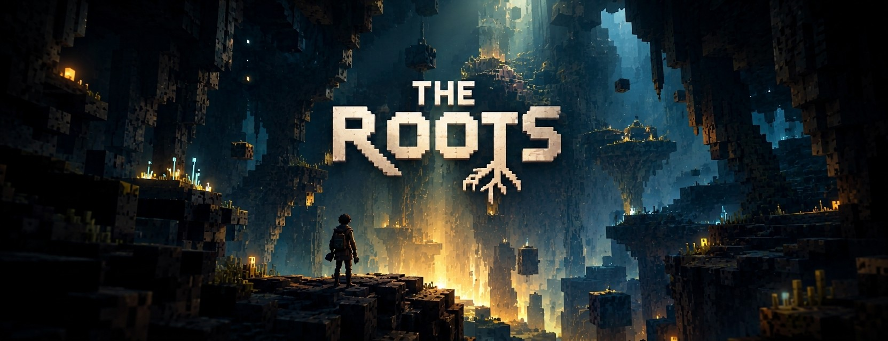
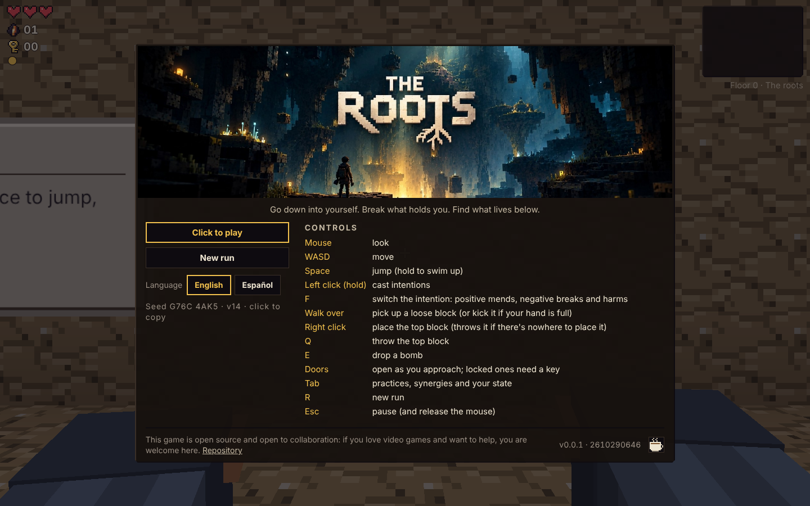
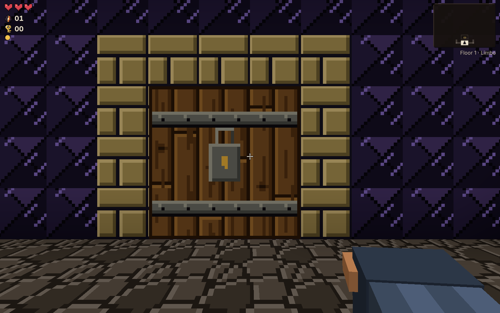
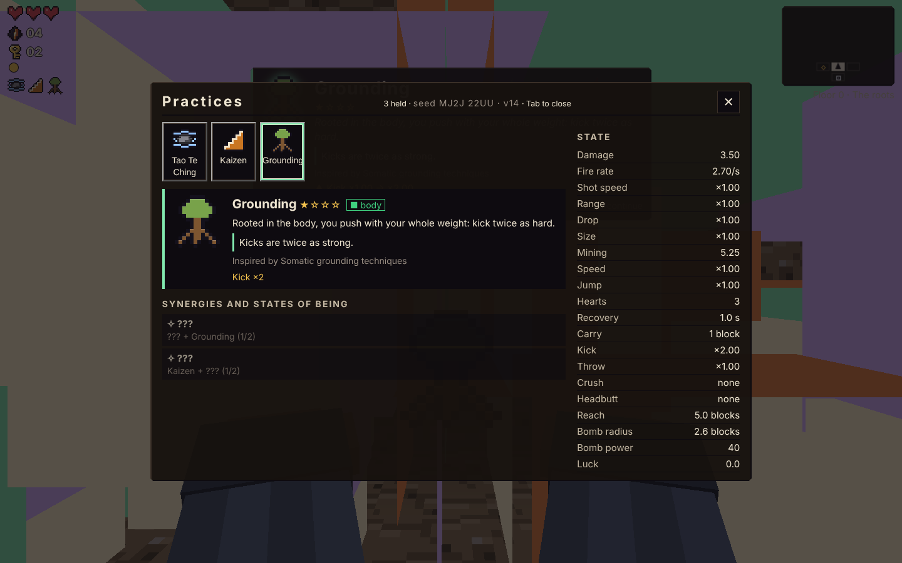

# THE ROOTS

<p align="center">
  
</p>

**A first-person voxel roguelite about going deeper: break the structures that hold you, meet the patterns and the creatures down below, and grow.**

Think of it as *Minecraft* and *The Binding of Isaac* had a child: a world made of cubes you can break, carry and build with, and runs where every item changes how you play.

<p align="center">
  <a href="https://sotano-yeagobs-projects.vercel.app"><b>▶ PLAY IN YOUR BROWSER</b></a><br>
  <a href="https://sotano-yeagobs-projects.vercel.app">https://sotano-yeagobs-projects.vercel.app</a><br>
  <sub>No install. Desktop browser with a keyboard and mouse, a gamepad, or a phone in landscape.</sub>
</p>

<p align="center">
  <a href="https://buymeacoffee.com/yeagob"></a>
</p>

---

## What it is

You go down into the layers of your own mind. The roots are the first floor, a peaceful place with every door open and a lesson on every wall. Below them, nine circles are waiting, each darker, older and more complex than the one above, until the frozen bottom, and then silence. Above the roots a giant tree rises into the sky, and its branches reach towards a sky full of stars.

Every wall is something you built to stay safe, and it now keeps you small. Every enemy is a **projection**: a pattern that blocks you from going after what you want, given a body of the same cubes as the walls. Every creature is something that stayed alive in you anyway. Every item is a **practice**: something people have used to grow, and picking it up changes not only what you can do, but **who you are**.

The game is about intention. What you aim your will at changes the world around you.

---

## Screenshots

<p align="center">
  
</p>
<p align="center">
  
  
</p>

---

## The core ideas

### Intentions and blocks

Your shot is an **intention**. While you hold your focus it flies straight; let it go without follow-through and it drops. Intentions break blocks, and blocks are structures: a belief, a habit, an avoidance. Some break with one look, some take sustained effort, and the deepest ones are the oldest.

What you break becomes material. You can carry one block at a time, kick it, throw it or place it again, so every wall you dismantle is a wall you can build something new with.

Intentions have a **polarity** (**F** to switch). A positive intention mends: it turns projections into allies and heals creatures. A negative one wounds everything it touches, your allies and the creatures included, and it is the only one that breaks the hardest blocks.

### Projections, not monsters

Enemies are the patterns that stop you, in bodies of the room's own matter. They are always patterns, never people or diagnoses, and each one behaves like the pattern it stands for, so the mechanic teaches the metaphor without a word of text:

- **Doubt** walks at you, stops to reconsider, and reaches for you before its touch can hurt. Slow and persistent; easy to outpace if you keep moving.
- **The Inner Critic** keeps its distance and lobs judgements in arcs. Dangerous when you stand still.
- **Panic** rushes you, swells, and **bursts**, breaking the blocks around it. Destructive, and it also opens paths.

Rooms work like *The Binding of Isaac*: the doors stand open while a room holds no projections. When you enter one that does, they seal, and the projections rise from the room's own matter, each one announced first. They open again on their own when the room is clear. A breakthrough destroys a door for good.

### Creatures and presences

Not everything down here is hostile. **Creatures** are the living things of the depths: curious, playful, resting, caring. Some are harmed by negative intentions and healed by positive ones, and they vanish into the blocks when a room seals. **Presences** are the wise beings who speak with you: short, kind lines, sometimes a question, never a cure. The bestiary of both is in the [design documents](docs/design/BESTIARY.md).

### Practices and states of being

Practices are named after **techniques and concepts** people use to grow: Kaizen, Exposure, Box Breathing, Deep Focus, Habit Stacking, and public-domain works such as Marcus Aurelius' *Meditations*, Seneca's *Letters* and Lao Tzu's *Tao Te Ching*. Modern books and courses are credited as inspiration in each item's description, never used as a name. Practices aren't magic cures, and therapies aren't jokes.

Practices sit on four paths: **Body**, **Mind**, **Emotion** and **Will**. Hold three of the same path and you reach a **state of being** (Embodied, Lucid, Open-hearted or Resolute): a bigger change you can see and feel.

### Elements

Water to wade or drown in, lava to keep away from, fire that eats crates. Water on lava makes obsidian. Each projection reacts to elements in its own way: Panic calms in water and goes off in fire.

### A love letter to games

The project is full of small winks at the games its makers grew up with: a phrase that echoes a famous line, a mechanic that feels like an old friend. Winks, never copies: no names, assets, music or trademarks from other games. Every wink has to mean something in the story too.

---

## Controls

Three complete schemes; the game follows whichever device you used last (details: [docs/architecture/input/](docs/architecture/input/README.md)).

| Action | Keyboard and mouse | Gamepad | Touch (landscape) |
|---|---|---|---|
| Look | Mouse (click to capture it; **Esc** releases it and pauses) | Right stick | Drag on the right |
| Move | **WASD** | Left stick | Left thumb (floating stick) |
| Jump (hold to swim up) | **Space** | **A** | The arrow |
| Cast intentions | **Left click** (hold) | **RT** (hold) | The bead of light (hold; drag to aim) |
| Switch the intention's polarity: positive mends projections into allies, negative harms them and your allies and is the only one that breaks blocks | **F** | **LB** | Double tap the bead of light |
| Pick up a block or a part | Walk over it with room in your hand | same | same |
| Kick a block or a bomb | Walk into it (blocks: with your hand full) | same | same |
| Place the top block or part (throws it if there's nowhere to place it) | **Right click** | **LT** | The block with an arrow |
| Throw the top block or part | **Q** | **B** | The flying block |
| Drop a bomb | **E** | **RB** | The seed |
| Open a door | Doors open by themselves when there are no projections; locked ones open with a key; a breakthrough destroys any door | same | same |
| Inventory and stats | **Tab** (or **I**) | **Y** (d-pad moves, **B** closes) | The grid (top) |
| Pause | **Esc** | **Menu** | The two bars (top) |
| New run | **R** | **View** (paused or dead) | "New run" on the landing and the pause card |

Language: English or Spanish, picked from your browser. Switch it on the menu (it's remembered) or with `?lang=es` in the URL.

---

## Quickstart

### Play it

Open **[sotano-yeagobs-projects.vercel.app](https://sotano-yeagobs-projects.vercel.app)** and click the screen. That's it.

Every run gets a fresh seed, shown as `ABCD EFGH` on the pause, inventory and death screens. Share a run by adding `?seed=ABCD-EFGH` to the URL: it replays exactly.

### Run it locally

Requires **Node 20+**.

```bash
git clone https://github.com/yeagob/sotano.git
cd sotano
npm install
npm run dev
```

Then open **http://localhost:5174**.

| Script | What it does |
|---|---|
| `npm run dev` | Start the dev server with hot reload |
| `npm test` | Unit tests (Vitest), including a 378-combination synergy matrix |
| `npm run typecheck` | TypeScript, no emit |
| `npm run build` | Typecheck and production build into `dist/` |
| `npm run preview` | Serve the production build locally |

### Debug console

**F3** toggles the debug readout. **`?gallery`** opens the art review page. In the browser console, the `S` object gives you tools:

```js
S.give('taoteching')    // gain a practice
S.god()                 // invulnerable
S.bombs(5); S.keys(2)   // counters
S.floor()               // drop to the next floor
S.enemies()             // live projections
S.seed()                // this run's seed code
S.restart('ABCD-EFGH')  // replay a seed
```

The full list is in [docs/architecture/OVERVIEW.md](docs/architecture/OVERVIEW.md#debug-console). For testing, `?sandbox` opens a creative room and `npm run sandbox` runs scripted scenarios headless ([docs/architecture/SANDBOX.md](docs/architecture/SANDBOX.md)).

---

## What's in the game today

- **A stacked dungeon of ten floors.** The roots (floor 0) are a friend with every door open and a fixed plan: three doors from the start, a treasure room that teaches the practices, a way down, and a ring of lessons that comes back to the treasure room. You can skip it. Then nine circles, each built from hand-made room templates and laid out Isaac-style: start, normal rooms, treasure, boss and sometimes a locked vault. Rooms can spread into the empty space around them (long galleries, stepped wells, caverns) while the map keeps one cell per room, under vaults of many shapes, and every floor is built from its own materials. Beating a boss reveals its practice and cracks a hole in the floor. The way down asks a toll (a heart, a key, a bomb, a block from your hand; from the sixth floor practices, more on every floor), and you choose what to give in a window: then you fall into the next one. A minimap fills in as you go.
- **Forty projections** that seal the room and fight you, from Doubt and the Inner Critic to Panic and What-if, each with its own attack and its own reaction to the elements.
- **The giant tree above.** Built in stories, each a hall of its own joined by spiral stairs, loaded only as you come near.
- **Creatures** of the depths that never seal a room and never die: a positive intention heals them, a negative one sends them into the blocks.
- **Survival** with Isaac-style hearts drawn in quarters, invulnerability frames after each hit and a death screen when the intention fades.
- **Elements.** Water to wade or drown in, lava to keep away from, fire that eats crates. Water on lava makes obsidian. Each projection reacts to elements in its own way: Panic calms in water and goes off in fire.
- **Practices and synergies.** Thirty practices from quality 1 to 4, with a clear effect line on every pickup. Synergies such as **Somatic Release**, **Compound Effect** and **Flooding**, plus the four states of being.
- **Unique runs.** Layouts, room moods, rewards and projections all come from the seed.

The full catalogue is in [STORY.md §5](docs/design/STORY.md#5-items-practices-with-real-names). The thirteen floors, as built and as designed, are in [LEVELS.md](docs/design/LEVELS.md).

---

## Open source and collaboration

THE ROOTS is an **open-source project** and it is **open to collaboration**. Anyone who loves video games and wants to help is welcome: code, art, sound, level design, writing, translations, testing or ideas. The goal is for the game to grow with its community and to become a good game that people enjoy and that helps them.

- **Find the work:** the [roadmap](#roadmap) and the [design documents](docs/README.md) say what is built, what is designed and what is open.
- **Open an issue or a pull request** on the [repository](https://github.com/yeagob/sotano). Read the [Contributing](#contributing) section first.
- **Support the project:** if you enjoy it and want to keep it going, you can [buy me a coffee](https://buymeacoffee.com/yeagob).

---

## Roadmap

| Milestone | Goal |
|---|---|
| **M0: Toy** ✔ | One breakable room: cast, break, pick up, kick, place, throw |
| **M1: One floor** ✔ | Generated floors from templates, doors and keys, treasure, boss and vault rooms, items, synergies, minimap |
| **M1.5: Combat and depth** ✔ | Stacked floors descended by falling, projections with navigation, health, bombs, inventory, quality-4 practices |
| **E: Elements** | Chests, fire and burning barrels, water, lava, mud and sand, furnaces, electricity ([plan](docs/architecture/ELEMENTS.md)) |
| **M2: Synergies** | Projectile behaviours, weapon types, more projections, bosses made of breakable voxels |
| **M4: The tree** | The upper floors of the giant tree, special blocks and practices that carry you through them, saved runs |
| **M5: Secrets** | Hidden pockets, side biomes, seed-dependent recipes, creatures and presences, meta-progression |

---

## Documentation

The full index is [docs/README.md](docs/README.md). By block:

**Design: the game and what it means**
- [Game design document](docs/design/DESIGN.md): pillars, loop, blocks and tiers, dungeon structure, scope, open questions.
- [Story and metaphor](docs/design/STORY.md): premise, mechanics as metaphor, states of being, enemies as projections, naming rules.
- [Bestiary](docs/design/BESTIARY.md): projections, creatures and presences, bosses by zone, seals, omens and waves *(design)*.
- [Levels](docs/design/LEVELS.md): the thirteen floors *(direction)*, rooms with height and element rooms *(built)*.
- [Elements](docs/design/ELEMENTS.md): fire, water and lava *(built)*; mud, electricity, furnaces, chests *(planned)*.
- [Stations, props and zones](docs/design/STATIONS.md): kitchen, forge, laboratory, garden and how they help you climb *(ideas)*.

**Architecture: how the code works**
- [Overview](docs/architecture/OVERVIEW.md): module map, frame order, core systems, debug console, tests.
- [Items](docs/architecture/ITEMS.md): the item model, the stat and event contract, synergies, safety layers.
- [Rooms and floors](docs/architecture/ROOMS.md): floor plans, room templates, doors and keys.
- [Entities](docs/architecture/ENTITIES.md): stacked floors, health, pickups, bombs, enemies and navigation.
- [Actors and factions](docs/architecture/ACTORS.md): the player and projections as actors, one damage pipeline.
- [Seeds and randomness](docs/architecture/RNG.md): seed codes, structure and runtime randomness, weighted tables.
- [Localization](docs/architecture/LOCALIZATION.md): English and Spanish, catalogs, live language switching.
- [Elements](docs/architecture/ELEMENTS.md): the element layer, reactions, rendering and the plan for containers.
- [Sandbox and lab](docs/architecture/SANDBOX.md): a creative room for testing, and deterministic scripted runs with text reports.

**Lore: references and cosmology**
- [Source library](docs/lore/SOURCES.md): every book, tradition, technique, therapy and game the work draws on.
- [Concept glossary](docs/lore/CONCEPTS.md): each idea and where it shows up in the game.
- [Cosmology](docs/lore/COSMOLOGY.md): as above, so below: the depth and the tree as mirrors, and the endgame.

**Research and reviews**
- [Technical research and proposal](docs/research/TECHNICAL.md): how Isaac and Noita are built, the target architecture, roadmap.
- [Architecture reviews](docs/reviews/README.md): engineer, architect and mediator reviews of key decisions.

---

## Contributing

Early days, and open to everyone. Before opening a pull request:

```bash
npm run typecheck && npm test
```

- Comments, docs and identifiers are in **English**. Follow the [project skills](.claude/skills/).
- Content (materials, items, rooms, enemies) is data in `src/content/`. Prefer adding data and hooks over special cases in the game loop.
- Player-facing text lives in `src/i18n/` in every shipped language.
- If you change behaviour, update the matching doc in `docs/` in the same change.
- **No third-party game assets or names.** Practices use generic technique names or public-domain works, and credit modern works only as inspiration.

---

## Support the project

THE ROOTS is built in the open, in spare time, for players. If it gives you a few good hours, you can help keep it going with a coffee: **[buymeacoffee.com/yeagob](https://buymeacoffee.com/yeagob)**. Thank you.

---

## License

Not chosen yet. The proposal is MIT for code and CC BY 4.0 (or BY-SA) for original art and sound. See [docs/research/TECHNICAL.md §14](docs/research/TECHNICAL.md#14-open-source-and-intellectual-property-important).

## Credits

Born from a voxel gift game made for a friend who finished *The Binding of Isaac*. Inspired by *Minecraft* (Mojang), *The Binding of Isaac* (Edmund McMillen / Nicalis) and *Noita* (Nolla Games). Practices draw on the works and techniques credited in the [source library](docs/lore/SOURCES.md). THE ROOTS is not affiliated with or endorsed by any of them.
