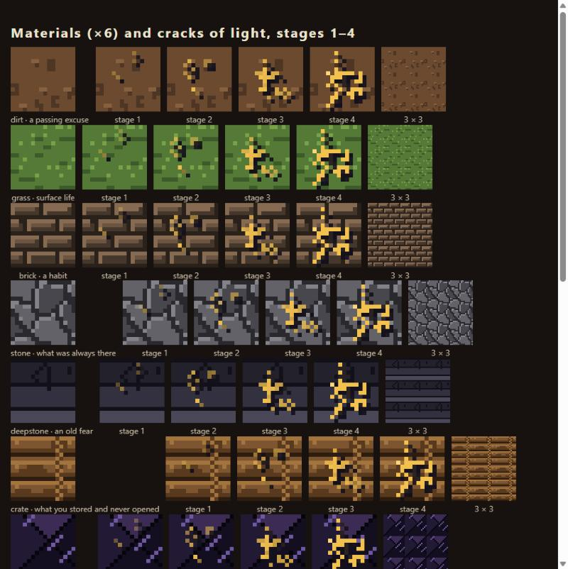
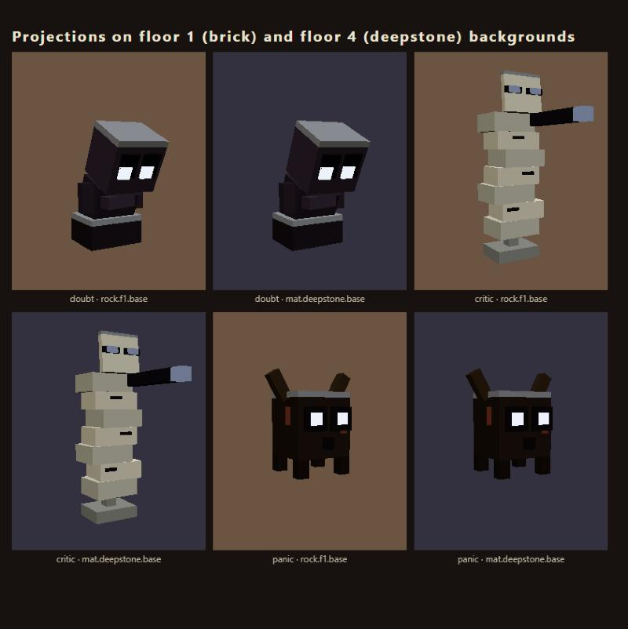
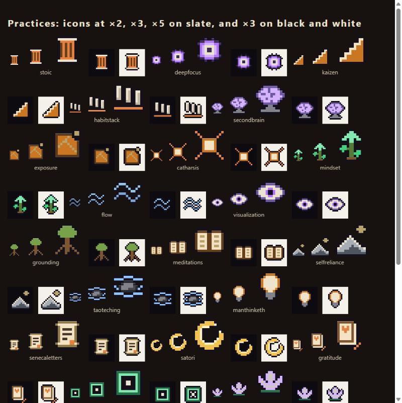
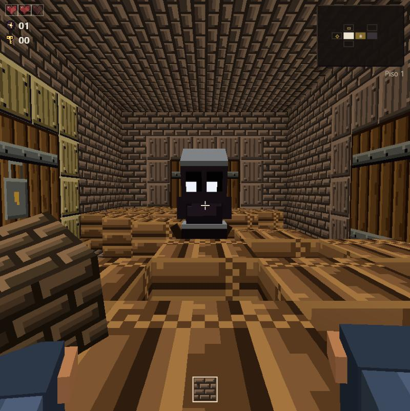
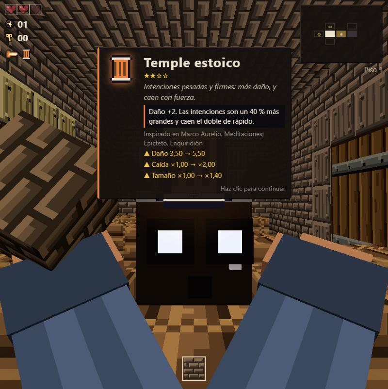
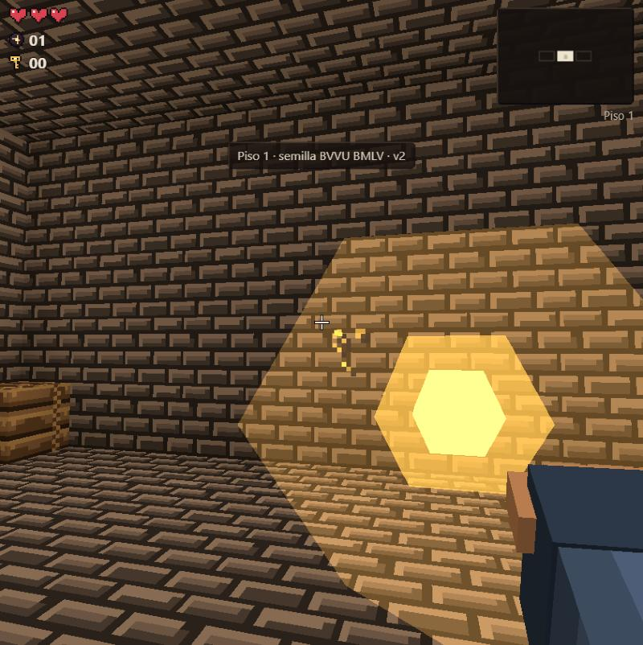
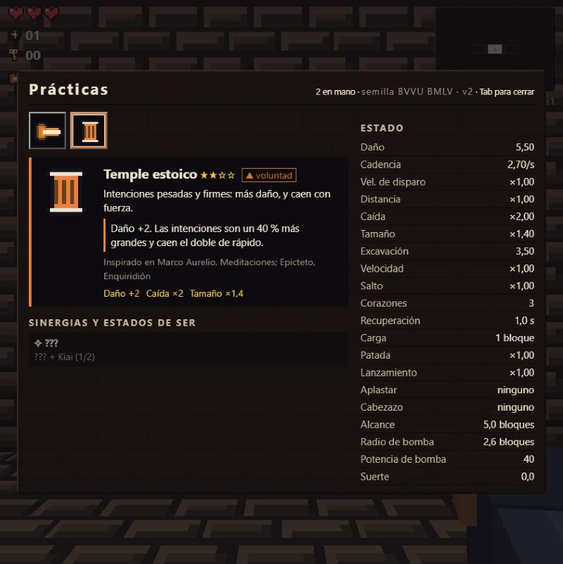
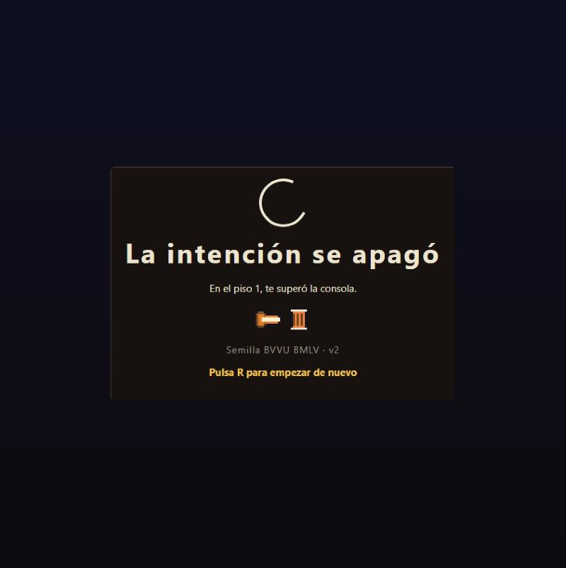

# Art guide: Vessel Light

The reference for every visual element in The Roots: how it is built, what it means, its colours, proportions and rules. Anything the player sees must follow this guide. The full reasoning and every number are in [DECISIONS.md](DECISIONS.md), the binding ledger from the art-direction debate; where the two disagree, the ledger wins. Use the [`sotano-art`](../../.claude/skills/sotano-art/SKILL.md) skill for any proposal that generates art.

Status: **direction agreed in debate and accepted by the owner; not yet built.** Phase 0 (palette and gallery) is starting; see the ledger's §12.9.

---

## 1. The style

**Vessel Light.** *The world is a husk; light is what it holds. Dark, cold, quiet matter; warm light is always earned, and it is always yours.*

The style follows five pillars. Each one has a test that a machine or a gallery capture can check.

| # | Pillar | Rule | Test |
|---|---|---|---|
| 1 | **Husk and light** | Found matter is dull (OKL lightness ≤ 0.62, chroma ≤ 0.06). Emissive pixels are OKL ≥ 0.70. | Tile pixel scan in `tests/art.test.ts` |
| 2 | **Warm is earned, and yours** | Warm light appears only where the player acted: intentions, shards, seams, practices, cleared rooms, lit lamps. Projections are cold. | Namespace scan; every emissive source declares its `cause` |
| 3 | **Made of the world** | 16 texels per block for everything. One shading model, no scene lights. Colours only as palette tokens. | Hex scan (zero literals outside `palette.ts`); no light classes in `src/` |
| 4 | **Everything means one thing** | Every asset links to a concept in `docs/lore/CONCEPTS.md`. Reserved colours and motifs keep one meaning. | `concept:` id exists; reserved tokens only from allow-listed modules |
| 5 | **The world remembers you** | Every act leaves a lasting mark: cracks glow, placed blocks carry gold seams, cleared rooms stay warm. | Unit tests on the placed flag and the room state; gallery captures |

**Two guarantees bound every pillar.** *G1 Readable first:* mood lives in the walls, clarity in the actors (every projection has an emissive tell, paths keep ΔE ≥ 20 under colour-blindness simulation, UI text ≥ 4.5:1, fog far never under 24). *G2 Gentle by design:* nothing flashes faster than 3 Hz, the HUD never distorts to express a mood, defeat is release, not gore.

Minecraft gives the block grammar; Noita gives "light is matter, and it burns in the dark"; The Binding of Isaac gives tender, iconic creatures. We copy principles, never assets, names or palettes.

---

## 2. The three sides

Everything on screen belongs to exactly one side. The side decides its colour, value and glow.

| Side | What it is | Colour | Glow |
|---|---|---|---|
| **World / vessels** | Blocks, rooms, doors, pedestals, the house | The floor's rock ramp. Low chroma, cooler and darker with depth | Never, unless cracked by the player (gold crack cores) or holding an element (lava, fire) |
| **The light / the player** | Intentions, shards, seams, practices, keys, breakthroughs, hands, cleared-room light, the lantern | Gold-white `light.*` ramp, with the path hues as rims and trails | The only side that emits freely |
| **Projections / husks** | Enemies, bosses, hostile shots | The host room's pattern, pushed to a cold shadow. Cold `cold.*` eyes; a shot or live mark that hurts is the attack red, and its warning is yellow (`attack.red.*` and `attack.warn.*`, §3.4) | Eyes, and the bright marks of a live attack. Captive light shows only through cracks |

**Ownership axis: warm is yours, cold is theirs. Shape decides first, colour confirms.** Player shots are round with a smooth trail. Hostile shots are tumbling cubes (or the Critic's ✗) with a jagged trail and a dark rim. Warm light seen inside a projection is *your light held captive*: it never flies at you.

---

## 3. Palette

All colours live in `src/content/palette.ts` as named tokens (`light.gold`, `path.body.base`). Content refers to tokens, never to hex. Every token has exactly one hex.

### 3.1 Ink, bone and ash

| Token | Hex | Use |
|---|---|---|
| `ink.void` | `#0E0B10` | Deepest shadow, eye sockets, outlines |
| `ink.line` | `#14111C` | Icon outline, ✗ marks, hexagram ground |
| `ink.panel` | `#17120F` | UI panel (α 0.95) |
| `ink.bevel` | `#3A2F27` | Panel bevel highlight |
| `ink.ash` | `#3A3236` | Visited, uncleared rooms on the map |
| `bone.paper` | `#EDE4D0` | Primary text (14.7:1 on panel), hexagram lines |
| `bone.dim` | `#C4B8A3` | Secondary text (9.5:1) |
| `bone.faded` | `#9A8F84` | Faded text, unvisited map outlines |

No pure `#000` or `#FFF`, except 1–4 px cores of `light.core`.

### 3.2 Floor rock ramps (outline / dark / base / hi)

| Floor | Element | outline | dark | base | hi | Feel |
|---|---|---|---|---|---|---|
| F1 | Earth | `#2A211A` | `#45372B` | `#6B5442` | `#866A52` | Warm umber cellar brick |
| F2 | Water | `#1F242C` | `#343A44` | `#4E5560` | `#69717C` | Damp blue-grey plaster |
| F3 | Air | `#1D1C26` | `#302F3B` | `#4B4A58` | `#64627A` | Slate-violet ledger stone |
| F4 | Fire | `#140F19` | `#241D2B` | `#3B3043` | `#52455D` | Obsidian-plum, polished by touch |
| Source | — | `ink.void` | `#1F1A22` | `#2F2833` | — | Absolute dark, with 1 px `light.core` stars |

### 3.3 The light

| Token | Hex | Use |
|---|---|---|
| `light.core` | `#FFF1C8` | Hottest pixel: intention core, seed core, stars below bedrock |
| `light.hot` | `#FFD77A` | Shard core, room-heart light, cleared-room warmth |
| `light.gold` | `#F2C14E` | Intention shell, crack cores, **kintsugi seams**, changing hexagram lines, keys |
| `light.ember` | `#EAA640` | Intention halo, lit lamps, breakthrough cracks |
| `light.dusk` | `#B8502A` | Dying light only: a falling intention |

### 3.4 Life

| Token | Hex | Use |
|---|---|---|
| `life.heart` | `#D9434F` | Hearts. **Red is reserved for life** |
| `life.dark` | `#7A1E2A` | Heart shade, hurt vignette (peak 0.35) |
| `life.empty` | `#4A2226` | Empty heart fill |
| `life.rim` | `#7A3A3E` | Empty heart rim |

**Attack red and warning yellow** (issue #47; owner ruling 2026-10-31): the warning of an attack that deals damage is `attack.warn.base` `#EEE33C` (a lemon yellow, not the player's gold; `attack.warn.dim` `#A8A02E` for a growing ring's reach), and its live blow is `attack.red.base` `#F23D33`, as is every hostile shot. Red is the only red besides hearts, and neither the warning nor the blow is ever a particle. Particles and decoration are the pale ramp, `cold.body` and `cold.white`.

### 3.5 The four paths (colour-blind verified)

| Path | Element | Glyph | `base` | `glow` | `dark` | `shadow` (projection tint) |
|---|---|---|---|---|---|---|
| **Body** | Earth | ■ | `#3FCF7F` | `#81E9AF` | `#276E46` | `#36634A` |
| **Emotion** | Water | ● | `#7AA3D4` | `#8EC1FF` | `#365981` | `#364A63` |
| **Mind** | Air | ◆ | `#B074FA` | `#D5B3FF` | `#5D1AB0` | `#4A3663` |
| **Will** | Fire | ▲ | `#CA7622` | `#E8803F` | `#66411C` | `#634D36` |

Glyphs are always shown next to the colour: colour never carries a path alone. The glyphs are the Platonic solids of the old elements (cube, octahedron, icosahedron, tetrahedron). The set keeps every pair at ΔE ≥ 24 under normal, deutan, protan and tritan vision. Gold and red are never path colours.

### 3.6 The cold (projections' side)

| Token | Hex | Use |
|---|---|---|
| `cold.white` | `#EEF2FA` | The eye of every projection, telegraph flare, the bright mark of a pale attack |
| `cold.body` | `#B9C6E6` | Particles and decoration (pale blue-white), danger ring |
| `cold.rim` | `#8E98B4` | 1-texel rim on dark husks |
| `cold.dim` | `#6F7891` | Wisps, sheen, chips |
| `cold.deep` | `#2A2F45` | Hostile shadows |
| `captive.ember` / `captive.smoulder` | `#8F3A1C` / `#4A1E12` | Captive light, dim, seen only through cracks |

### 3.7 Elements, sky and bridge materials

- **Fire:** `#A8200D`, `#FF5A1F`, `#FFB13B`, core `#FFF1A8`. **Lava:** `#C2410C` / `#FF7A1A`, vein `#FFD25A`. **Water:** body `#1D4B6E` (α 0.7), surface `#4F9CC8`, foam `#BFE6F2`. **Mud:** `#1E150C` to `#6A5440`. **Sand:** `#7A6338` to `#E3C88F`.
- **Sky:** dawn low `#E8573C`, dawn high `#BFD8F0`, day `#8FC4E8`, horizon `#F3E2C4`, albedo `#F4F1EA`.
- **Bridge materials:** brass `#5E4F2A` to `#B9A26A` (never emissive; the Impostor's false gold), iron `#2A2D33` to `#A8AEB6`, limestone `#4A4640` to `#CFC8BE` (pedestals), copper `#8A5A3A` to `#D4A27A` (ore nodules).
- **Skin tones** (hands; player setting): `#F3D2B3`, `#E2B48F`, `#B98260` (default), `#9A6844`, `#6F4A30`, `#4A3020`.

### 3.8 Reserved colours

1. **Gold (`light.*`) is the light and repair.** Never on a living projection, never a path colour.
2. **Red (`life.*`) is life.** Hearts and heart-related UI only. The attack red (`attack.red.*`) is the one other red: the marks and shots of attacks that deal damage.
3. **Cold (`cold.*`) is the projections'.** Never on a player shot, shard, seam or practice.
4. **Path true hues belong to the player.** Projections use only the `shadow` tint; the true hue appears only on their release shard.
5. **The skin band is banned on projections** (hue 15–45°, low chroma, mid-to-high lightness).

---

## 4. The descent

The run goes down through four floors, the source below bedrock and the sky, and comes back up. Each floor follows the alchemical stages (nigredo going down, albedo at the source, citrinitas on the climb, rubedo at the surface).

| Station | Element | Stage | Rock | Fog | Near / far (uncleared) | Ambient (RGB) | Accent |
|---|---|---|---|---|---|---|---|
| **F1** Cellar of habits | Earth | nigredo | `rock.f1` | `#1E1712` | 6 / 32 | 0.60, 0.55, 0.50 | Dust motes; one lamp per room, lit once the room is cleared |
| **F2** Rooms of feeling | Water | nigredo | `rock.f2` | `#121A22` | 5 / 30 | 0.46, 0.47, 0.54 | Water glints `#7FC3D9` |
| **F3** Old structures | Air | nigredo | `rock.f3` | `#15151F` | 5 / 27 | 0.38, 0.38, 0.45 | Cold slit light `#B9B4E8` |
| **F4** Oldest pain | Fire | deepest nigredo | `rock.f4` (polished) | `#0C0910` | 4 / 24 | 0.31, 0.28, 0.35 | Lava `#FF7A1A` |
| **Source** | — | albedo | `rock.source` + stars | `ink.void` → `#F4F1EA` | 3 / 24 → 40 / 120 | 0.15 → 1.0 | One white crack widening over ≥ 1.5 s |
| **Climb** | — | citrinitas | same rock | each cleared room 30 % toward `#3A2E14` | cleared values | ×1.15 in cleared rooms | Lamps you lit, gold seams |
| **Surface** | — | rubedo | grass may reach chroma 0.13 | dawn gradient to day | 36 / 114 | 1.00, 0.98, 0.92 | The sun |

Fog far is never under 24; floor 4 ambient is never under 0.30. A cleared room is warmer than an uncleared one on the way down or the way up.

---

## 5. Lighting

**One model, three layers, zero scene lights.** Every cube (chunks, debris, held block, doors, pickups, creatures, hands) uses the same unlit shading. `HemisphereLight` and `DirectionalLight` are removed.

1. **Baked (mesh time, in the worker):** face shade × ambient occlusion × RGB block light, written into vertex colours. Convert authored values from sRGB first (three r186 vertex colours are linear, so the current bottom shade displays too bright). Face shades: top 1.0, ±X 0.78, ±Z 0.62, bottom 0.42. Block light is a flood fill, levels 0–15: lava 12, fire 10, lit furnace 8, room heart 8 (cleared rooms), lit lamp 7, pedestal holding a practice 6, breakthrough seed 4, mended block 2.
2. **Per frame (uniforms):** the floor look (fog, tint, shade contrast, ambient), the cleared state of each room, the lantern (radius 6 m, 35 % of `light.core`, +0.5 m per state of being), and two virtual lights for flashes and the held shard.
3. **Emissive texels:** bypass the shade and 70 % of the fog. Used for eyes, seeds, shards, cracks and the intention core.

**The room heals (clear wave).** When the last projection in a room is released, a front expands from the room centre at 9 m/s. Behind it the room goes from held (saturation ×0.65, value ×0.85) to released (value and saturation back, a warm tint of `light.hot` at 4 %, ambient ×1.15). Cracks flare and settle as embers, 60 gold motes rise, the fog lifts, and the room's door keystones flare once. No shake, no flash.

---

## 6. Blocks

### 6.1 Texture grammar (16 × 16)

- **Ramp:** outline, dark, base, hi, plus an optional accent (≤ 8 pixels) and an optional emissive mask.
- **Shapes, not noise.** Each shape (brick, plank, plate, pebble, nugget) gets a 1 px highlight on top and left, and a 1 px shadow on bottom and right. Light always comes from the top left.
- **Features ≥ 2 px.** Single-pixel variation stays under 10 % of the tile.
- **Four variants** per common material, picked by a hash of the position, seamless.
- **Grain carries meaning.** Found matter has horizontal grain (laid down); built matter has vertical grain (rising).
- **Deeper is bigger and older:** F1 bricks 7×3; F2 plaster slabs 8×8; F3 slate courses 16×3; F4 facets about 6 px with one long highlight.
- **Glow budget:** common blocks ≤ 6 % emissive pixels; special blocks ≤ 15 %; lava ≤ 45 %.

**Never:** X-braced crates, cobblestone layouts, full-tile random speckle, smooth gradients.

### 6.2 Existing materials

| Material | Look | Cracks follow | Break particles |
|---|---|---|---|
| **Dirt** | Soft round clods lit on their top rims, a few crumbs and two small pale pebbles; no straight lines | Short crumbling strokes | 8 chips, 4 dust puffs |
| **Grass** | Top: bladed greens with 1×2 highlight ticks. Side: dirt with a ragged fringe | As dirt | Chips and blade slivers |
| **Brick** | Running bond, 7×3 bricks, warm floor-rock ramp | Mortar first | 10 chips, some brick halves |
| **Stone** | 4–5 Voronoi plates, each one tone, facets | Long straight strokes that turn at plate edges | Angular chips, heavy |
| **Deepstone** | Three horizontal strata with lit bedding seams, flattened lenses, hairline veins | Along strata | 12 chips |
| **Packed earth** (floor 0) | Rammed earth: soft wandering compaction lifts, short cracks, a few pebbles and pores; never boards | Along the lifts | As dirt |
| **Rubble masonry** (floor 2) | Rough bevelled stones of varied size in dark mortar | As stone | As stone |
| **Ashlar** (floors 3–4, 9) | Two courses of cut, bevelled blocks with broken bond | As stone | As stone |
| **Slate** (floors 5–8) | Thin dry-stacked courses of short split slabs | Along the courses | As deepstone |
| **Crate** | A raised mitred frame around three recessed slats, grain streaks, a knot, six iron nail heads (no X brace, no rope band) | Splinters along the grain | Chips and tumbling splinters |
| **Living wood** | Sides: vertical bark with wandering crevices, splits and a little moss. Top and bottom: end grain with growth rings, a pith and a check crack | Along the grain | As crate |
| **Leaves** | Overlapping bevelled leaf clusters over dark gaps | As dirt | As grass |
| **Obsidian** | Three glassy triangles, diagonal accent streaks | Radial from the impact (conchoidal) | Chips and flat glass slivers |
| **Bedrock** | Dense low-contrast cobble, no highlight, never glows | Never cracks | A dull puff, no light |
| **Iron ore** | Stone with copper nuggets | As stone | Stone chips and copper chips |
| **Door frame** | Floor-rock ramp, dressed ashlar blocks in bond (never boards) | As brick | As brick |
| **Door leaves** | Six vertical boards with offset butt joints, long grain and knots, two iron bands | — | — |
| **Brass frame** (was "Gilded") | Brass ramp; keystone lights gold once the room is cleared | — | — |
| **Obsidian frame** (was "Bone") | Obsidian ramp with one crack of `captive.ember` pulsing at 0.4 Hz | — | — |
| **Pedestal** | Limestone, big bevelled blocks; a rim in the practice's path glow while a practice sits on it | As brick | 10 chips |
| **Breakthrough** (seed) | A dark seed with a pointed top split by one jagged `light.ember` seam with a white-hot heart (never a cross: on a cube it read as ✗). In the world it is a voxel seed model, not a cube | — | See §7 |

### 6.3 Cracks of light

Damage shows light from the first hit. Each crack stroke is a 1 px outline with a 1 px emissive gold core. Stage 1 has 2 strokes, stage 2 has 4, stage 3 has 6, and stage 4 has 8 with a faint halo. Bedrock never cracks.

### 6.4 Shards and kintsugi seams

**One light, two states: a broken vessel leaks light, a mended one shines along its break.**

- **Loose block (open vessel):** the material's tile, lifted slightly, with 2–3 short gold crack lines (not a full glowing border). Intensity rises with the block's tier (0.35, 0.5, 0.7, 0.9). It breathes at 0.5 Hz.
- **Held block:** 1.5 times the intensity. It lights your hand gold in a dark corridor.
- **Placed block (mended):** a 1 px gold seam along one or two edges, plus one crossing crack, steady at 0.30. Seams are always gold. Gold seams are the repair, the principle of kintsugi, which is proposed for the lore library *(owner)*.

### 6.5 Chests

A chest is *what you keep shut until you are ready*; open, it is *what was kept, given*. It is a small model on an invisible block, not a textured cube, so it must read as a chest by its silhouette alone: a long, low plank box (14 × 8 × 10 texels) under a stepped, domed lid, two metal bands, corner feet.

- **Free:** thin dark iron bands and a brass latch. No keyhole.
- **Locked:** heavier bands, pale iron feet and plinth, and a padlock hanging on the front with **one keyhole per key** it asks for. A lock is a belief that asks for as many insights as it holds.
- **Practice:** the same chest dressed in brass (bands, feet, trims); free or locked.
- **Open:** the lid swings back on its hinge, the padlock falls, and the dark inside holds a mound of gold light. The light is the only warm thing about a chest, and only once it is open.

Numbers and tokens: DECISIONS §6.5. Captures: `?gallery=chests`.

---

## 7. Intentions, hostile shots and particles

**The intention (player shot)** is a bead of light: an icosahedron with a `light.core` centre, a `light.gold` shell, a `light.ember` halo at 35 %, six ghost copies as a trail, and a rim in the dominant path's colour (≤ 40 % of the sprite). Items may change only its size, rim and trail colour, halo radius, ghost count and one special effect (ember, arc, ripple or spiral). Core and shell never change. When an intention runs out of range it loses its light and lands dim.

**Hostile shots** are tumbling cubes of `attack.red.base` (they hurt, so they are red), or the Critic's ✗ in the same red. They have a jagged trail and never carry warmth. Impacts are pale chips (`cold.body`). Never gold particles.

**Attacks** warn in yellow (`attack.warn.base`) while a blow that hurts is coming, turn red (`attack.red.base`) when it lands, and stay in the pale ramp when they do not hurt. Their particles are always pale, never red or yellow (DECISIONS §7.6).

**Particles** are two pools. *Matter* chips use the material's ramp (50 % base, 30 % dark, 20 % hi). *Light* is additive, with fog reduced. Each event has a cap, and above 80 % pool fill the events spawn half as many particles.

**Screen feedback is gentle.** Shake is positional only, with no camera roll, and chained events take the maximum, never the sum. Player hits give a short, muted vignette. Breakthroughs flash once at most and fade over 0.15 s. A placed breakthrough never blinks: the seed swells to 1.25 × and its seam and halo pulse faster as the fuse runs, from 0.8 Hz up to 2.5 Hz at most. Health at one heart beats the last heart on the HUD.

---

## 8. Creatures (projections)

### 8.1 The method

A projection does not ship until every step is written in its definition:

1. **Pattern → verb.** One sentence in the player's voice (*"Are you sure?"*) and the one verb it does in play.
2. **The need underneath.** "It wants you to ___." This drives the face, the death and the touching moment.
3. **Path.** Whose shadow it is (the path's `shadow` tint).
4. **Glyph.** A silhouette a child draws in three strokes, unique among all projections.
5. **Size class.** Height is meaning: smaller looks up and needs; taller looks down and judges.
6. **Value class.** Dark husk or pale husk, with the reason.
7. **Face.** Four frames: idle, telegraph, hurt, release.
8. **Motion.** A rhythm, a signature move, a tic, and a telegraph of at least 0.4 s.
9. **Sound.** A short motif that is dissonant in idle and **resolves** on release.
10. **Release.** The pose opposite its shape, and a shard.
11. **The touching moment**, in one sentence.

### 8.2 Body rules

- **Grid:** every box and offset is in whole texels (1 texel = 1/16 of a block). Limbs are 2 or 3 texels thick. No face detail under 2 × 2.
- **Host material:** the most common solid material within 4 blocks of the room centre, or the definition's preferred material. The creature takes the room's **pattern and grain, never its value**.
- **Dark husk** (Doubt, Panic, Procrastination, Distraction, Comparison, the Shadow, Resistance): body mean L* ≤ 14, with a 1-texel cold rim on the top and side edges.
- **Pale husk** (the Lectern, Perfectionism's shell, the Impostor's frame): body mean L* at least 20 above the host and at least 55, with a 70 % edge ring.
- **Overlay:** one motif on the skin (Doubt's wisps, the Lectern's ink ticks, Panic's cracks).
- **Outline:** an inverted-hull outline in `ink.void` is a setting ("high-contrast projections"), off by default.
- **Banned:** skin tones, human features, clinical props, real weapons, tears, religious figures, and any `light.*`, `life.*` or true path hue in content.

### 8.3 Eyes and faces

**The eye is a light in a socket.** A dark socket (`ink.void`) holds a 2 × 2 `cold.white` light that moves a texel to look at you, away or up. There is no pupil and no white of the eye. Idle brightness is 0.6, telegraph 1.0. Every projection has the same eye, so the family is recognisable.

Each projection has a face on the front plane with four frames. The release frame is always softer than idle. The head turns towards the player within ±45°.

### 8.4 Size classes

| Class | Height | Head share | Max parts |
|---|---|---|---|
| Small | 0.5–0.9 | 45–85 % | 10 |
| Medium | 1.0–1.5 | 35–45 % | 14 |
| Tall | 1.7–2.1 | 18–28 % | 16 |
| Boss | 3–6 | Face spans 2×2 to 4×4 blocks | Real voxels plus ≤ 48 detail boxes |

Absolute cap of 24 parts. Projections about safety or belonging get large heads; judging and comparing patterns get small ones.

### 8.5 Timing

- **Materialisation (0.9 s), at its spawn point** (owner, 2026-10-27: no longer always the centre; each spawn is first announced by an omen of cold motes, a crack and a spatial sound, [BESTIARY §2](../design/built/encounters/SEAL-AND-OMENS.md). The omen's 24 motes are `cold.dim`, turning `cold.body` in the second half of the gather, and the breach flares `cold.white`): a crack appears on the floor (or wall, ceiling, water), host cubes rise from the floor and walls, a hum starts, the body assembles bottom-up, and the eyes open last. It looks at you first. Invulnerable while it appears.
- **Animation:** poses step at 12 fps; positions move smoothly. Breath is ±3 % at the creature's rhythm. Joints (hips, shoulders) are pivots, never box centres.
- **Telegraph:** at least 0.4 s, on three channels at once: a face frame, one body part moving to an extreme, and a sound.
- **Hurt:** the hurt face for 0.15 s, the head knocked back 6–10°, a brief flash to the host's highlight (never pure white).

### 8.6 Release (death)

Hit-stop 50 ms, then the release face and release pose (0.3 s). The body dissolves into host-coloured chips that drain to grey, and gold motes rise. A shard, a small cube turned 45°, lifts 1.2 blocks over 1 s, carrying the projection's true path hue on its rim. The sound resolves. **No gore, no scream, no hurt frame at death.** The last image is a softer face.

### 8.7 Bosses become architecture

Bosses are made of real breakable blocks from their floor. Their eyes are luminous socket blocks. Each has a **core vessel** block that shows captive light through its cracks; exposing and hitting it triggers the release. When released, the boss's blocks become architecture: a stair, a bridge, a light.

### 8.8 Doubt: "Are you sure?"

- **Need:** it wants you to not fail. It keeps you still because still is safe.
- **Path:** Mind. **Class:** medium, dark husk. **Glyph:** `?`.
- **Silhouette:** a heavy sack of stones it drags, a hunched torso, a neck curling forward, and a large drooping head at 1.3 blocks. Its forearms cross over its chest, holding its own elbows.
- **Face:** two sockets with lights that look at you, then slide away after 0.6 s. The telegraph widens the eyes and opens the arms: it reaches for you.
- **Motion:** a slow breath (0.4 Hz), stepped scoots, and a pause every ~1.4 s to reconsider (0.5 s, head turning). The pause opens an escape window: *a behaviour change, owner decision.*
- **Telegraph:** 0.5 s, arms open, a rising minor second that never lands.
- **Release:** it stands up straight, so its "?" becomes a "!" for 0.3 s. Then it dissolves.
- **Touching moment:** it never attacks on purpose; it holds on so you don't go. Released, it finally stands up straight.

### 8.9 The Lectern (Inner Critic): "That's not good enough."

- **Need:** it wants you to be accepted, so it judges you first.
- **Path:** Mind. **Class:** tall, pale husk. **Glyph:** `Γ`.
- **Silhouette:** a stack of seven ruled pages on a post, a mask, and a quill as its pointing arm. It has no legs, no torso and no hands. It glides and never walks. It is 1.9 blocks tall, looking down.
- **Palette:** cold chalk `#C9CFD8`, ink ticks `ink.line`, and a 5 × 5 ✗ on the back of the stack. **Not red:** the old red pen is life's colour, so it is ruled out.
- **Telegraph:** the quill rises, the nib brightens to full, and a dry "tsk-tsk" falls a tritone. Its judgement is a red ✗ in an arc (a shot that hurts), and it leaves an ink ✗ mark on the floor for 3 s.
- **Release:** the pages fan open, blank, and the stack bows forward for the first time.
- **Touching moment:** you see the ✗ on its own back. It judges first because it is the most afraid of being judged. Released, its pages are blank: room to begin.

### 8.10 Panic: "Something is wrong, something is wrong."

- **Need:** it wants to protect you. It is an alarm that rings when nothing is on fire.
- **Path:** Will. **Class:** small, dark husk. **Glyph:** `✳`.
- **Silhouette:** a near-black cube, all head, with two arms raised over its head and four quick legs. About 0.8 blocks tall.
- **Core:** a captive-light core visible through hairline cracks.
- **Telegraph:** a 0.9 s fuse in three stepped swells. The core brightens from smoulder to ember to white on the last step. Each thump sounds on its body, never through the whole screen.
- **Burst:** a short white sphere that breaks the blocks around it.
- **Release before bursting:** it sighs, shrinks, and dissolves into a shard. If it bursts, the ember shard stays in the new opening.
- **Touching moment:** tiny and terrified, with its hands up, it shuts its eyes before it goes off. What it breaks is often the way forward.

### 8.11 Next projections and bosses (sketches)

| Projection | Need · path · class | Body and motion | Release |
|---|---|---|---|
| **Procrastination** "Later." | rest · Will · medium, dark | Three crooked stacked crates, sleepy; a smaller box tucked under its arm | The last crate settles into a loose crate you can carry |
| **Distraction** "Ooh, what's that?" | relief, novelty · Mind · small, dark | A moth: a cube body, flapping wing plates. Its eyes look at the nearest light, never at you | It lands, folds its wings and looks at you for the first time |
| **Perfectionism** "Not yet." | to be loved without fault · Body · tall, pale | A marble-like shell of plates over a small rough figure | Broken plates drawn back with gold seams: whole and visibly mended |
| **Comparison** "They're ahead of you." | to know where you stand · Emotion · tall, dark | An obsidian mirror slab on a pedestal, always taller than you. Its face is a blurred reflection | At death it is exactly your height and stands beside you |
| **Resistance** (boss) | that nothing changes · Will | A door that walks; it blocks, then walls you in, then sits | Becomes a stair or a bridge |
| **The Impostor** (boss) | to be safe from being found out · Emotion | A hollow frame of brass (never gold), smiling too wide; inside, a small real figure | The small figure was the only real thing; it stands, then releases |
| **The Shadow** (boss) | to be seen, to come home · all paths | Your own silhouette in the room's negative, with your hands and your jumper | Shrinks into your hands, which keep a thin dark ring at the wrist |

---

## 9. Hands

The hands are the protagonist's only body. Each hand is three boxes (palm, thumb and sleeve) on the texel grid, with a **knitted jumper from the house above** for a sleeve. Skin tone is a player setting, never chosen for everyone. Casting is an open palm pushing forward, never a fist.

| State of being | Visible change |
|---|---|
| **Embodied** (Body) | Sleeves rolled up; dust specks at the knuckles |
| **Lucid** (Mind) | Light lines at the fingertips in the Mind glow |
| **Open-hearted** (Emotion) | The cuff mended with gold stitches; a soft palm glow while casting |
| **Resolute** (Will) | Cloth wrapped around the knuckles; a darker sleeve |
| **Shadow integrated** | A thin dark ring at each wrist |

The hands never tremble, and the screen never pulses to express the player's state.

---

## 10. Icons, HUD and UI

### 10.1 Item icons (12 × 12)

- At most four colours plus an outline. Fill at least 40 of 144 pixels.
- The silhouette must read in solid black, and at 28 px it must be recognisable.
- Icon colours come from any token except gold, red and cold, unless the item is itself about light (Satori).
- No text, letters, sacred names or religious symbols. The Tao Te Ching yin-yang is replaced by water flowing around a stone *(owner)*.
- Integer scales only, with nearest filtering: 2× in the HUD, 3× in inventory tiles, 5× in banners.

### 10.2 HUD and UI

- **Fonts** *(owner)*: Pixelify Sans for numbers and titles (20, 28 and 40 px), and Atkinson Hyperlegible Next for body text. Both are OFL. Minimum text size 14 px.
- **Panels:** slate-dark `ink.panel`, 1 px outline, 2 px inner bevel, chamfered corners, no rounded corners, no blur.
- **Hearts** top-left, eight points per heart, quarter-clips. Empty hearts use the empty tokens. The last heart beats when you are at one heart. Invulnerability dims the hearts; it no longer blinks.
- **Seed icon** replaces the cartoon bomb. **Keys** are keys with an eye.
- **Minimap** top-right. Marks are glyphs, never colour alone.
- **Banners** stay until clicked. **Toasts** appear top-centre and fade after 2.5 s.
- **Crosshair:** a cross that opens over a projection and forms an ✕ on a hit. Shape, not colour.
- **Debug readout is off by default.**

### 10.3 The run's hexagram

- Drawn from the bottom up, six lines. A solid line is 15 units wide, a broken line two 6-unit halves with a gap, and the whole hexagram is 15 × 33 units.
- The lines are bone on ink. Changing lines are gold, pulsing slowly.
- The six lines are the six stations: floors 1–4, the source, the sky. A line is dim until its station is completed.
- It appears on the start screen, on the pause screen, and at the end of a run. **Never on the always-on HUD.** It is an image of the world, not a prophecy.

---

## 11. Accessibility and safety

**Photosensitivity.** No element alternates faster than 3 Hz. A full-screen effect cannot retrigger within 333 ms. Item flashes peak at 0.45, the hurt vignette at 0.35, and saturated red never covers more than a quarter of the screen. The albedo moment is a ramp of at least 1.5 s.

**Settings on the first pause page:** screen shake (default 70 %), flashes (full, reduced or off), head bob, field of view 70–100, UI scale 100/125/150 %, reduce motion, high-contrast projections, skin tone, and a low-health vignette (opt-in).

**Colour.** Every meaning pair differs in shape as well as colour. Every screenshot is reviewed in greyscale and in the three colour-blindness simulations.

**Text.** At least 14 px, at least 4.5:1 contrast for body text, and never below 60 % opacity.

**Emotional safety rules:**

1. Projections are matter, not bodies: no skin tones, no realistic proportions, no naked figures.
2. Projections never speak to "you": no insults, no mocking, no quoting the player's failures back.
3. The player is never given a simulated panic: no tunnel vision, no screen-wide heartbeat, no trembling hands. Danger is mechanical and telegraphed.
4. Defeat releases, it does not wound: light shards and grey dust, no blood, no gibs, no screams.
5. Death is rest: "The intention faded", the ensō, "Begin again". The pattern is the agent ("Panic held you on floor 3").
6. The HUD stays honest: it never fades, distorts or flickers to express a mood.

**Red lines (never):**

- **Traditions:** no sacred names of God, no Hebrew letters, no labelled sefirot, no classic Tree diagram, no deities, saints, crosses, pentagrams, the eye in the triangle, or decorative yin-yang. Never a tradition, figure or practitioner as a projection.
- **Mental health:** no self-harm imagery, no asylums or straitjackets, no spiral "crazy" eyes, no diagnosis labels. No feature that codes body type, ethnicity, age, gender or disability.
- **Violence and family:** no blood or viscera. Parents, family, ancestors and the house are never enemies.
- **Copying:** no palettes, sprites, names, silhouettes or texture layouts lifted from Minecraft, The Binding of Isaac or Noita. No crying child, no tear projectiles.

---

## 12. Motifs and the meaning test

| Motif | Meaning | Use for | Never |
|---|---|---|---|
| **Crack of light** | the limit is already giving way | damaged blocks, captive light, the bottom of the world | the player's body or hearts |
| **Shard** | freed light carrying an intent | loose and held blocks, release shards | weapons; enemy shots |
| **Gold seam** | what was broken and rebuilt is stronger | placed blocks, rebuilt rooms | pre-placed world blocks |
| **Seed** | potential, a breakthrough waiting to open | breakthroughs, the start of a run | skulls, fuses, cartoon bombs |
| **Eye** | insight | keys, Lucid | projections' eyes (those are lights in sockets) |
| **Hand** | agency | first-person hands, open palms | a fist striking a figure. Pointing belongs only to the Lectern |
| **Six lines** | the reading of this moment | the run's hexagram only | decoration |
| **Ensō** | wholeness that accepts imperfection | Satori, the death screen, loading | buttons, reticles, frequent UI |

**Meaning test** for every new asset:

1. What does it stand for? One sentence in the story's voice and a concept id in `docs/lore/CONCEPTS.md`. If there is none, it is decoration.
2. Which side is it on, and do its colours obey that side?
3. What does the player's intention do to it? It must change, or be a fixed point with a stated reason.
4. Does it read with all text removed?
5. Would someone who lives this pattern, or belongs to this tradition, feel seen rather than mocked?

---

## 13. Pipeline

Principle: **one grid, one light, one palette, one review screen. Every rule has a test or a gallery view.**

- **`src/content/palette.ts`:** the only source of colour, with named tokens and the derived skin ramps.
- **`FloorLook` data** (`src/content/tables/floor-looks.ts`): one row per station with its rock ramp, fog, ambient and accent.
- **Creature format** (`src/render/creature/types.ts`): bones, texel boxes and face frames. Each projection is one merged mesh, one texture up to 128 × 128, and one draw call.
- **Glow:** emissive texels first, then instanced halos, then the light particle pool. No default bloom.
- **`?gallery`:** a review page with materials, every projection on a turntable, icons, HUD, palette and room-cleared states, plus colour-blindness and greyscale filters. Captures are deterministic, and they feed the reviews and the PDF.
- **Tests** (`tests/art.test.ts`): palette-only colours, namespace rules, ramp order, husk and light limits, path contrast, creature limits, icon rules, atlas collisions, concept ids, and golden hashes so art never changes by accident.
- **Budgets:** about 150 draw calls per frame on PC, 90 on mobile. One draw call per projection. Particle caps: 900 matter and 300 light on PC; 400 and 150 on mobile.

**Known bugs the debate found:** an enemy GPU leak (parts are never disposed); the texture atlas is full (a 16th material collides with the grass tile); inventory icons are scaled 2.86× (uneven pixels); limbs rotate around their centres; vertex colours are too bright; three lighting models; loose cubes show the top texture on all faces; ~140 hex literals in the source.

**Phases** (engineering days, art included where noted): 0, palette and gallery v1 (3.5 days); A, unified foundation, creature pipeline and tests (9.5); B, the look: textures, cracks, shards, seams, block light, clear wave, the three new projections and hands (15); C, HUD and accessibility (5.5); D, bosses, water, electricity, the Tree map and the remaining projections (about 21). A to C is about 33.5 days. Nothing new the player can see ships between Phase 0 and B without passing the gallery gate and the meaning test.

---

## 14. Owner rulings (accepted)

**Accepted by the owner on 2026-10-26: every recommendation below (the choice is in brackets).** The binding record is DECISIONS.md §14.

1. **Style name:** Vessel Light (recommended) or Lantern Clay?
2. **Fonts:** allow two OFL font files (about 80 KB) despite the "no image files" rule? [yes]
3. **Rename** "Bone frame" to Obsidian frame and "Gilded frame" to Brass frame? [yes]
4. **Behaviour changes:** Doubt's pause and a reach telegraph before contact now; the other mechanics with each projection's milestone. [yes]
5. **Shards:** cosmetic for now, or a pickup? [cosmetic now]
6. **Tao Te Ching icon:** replace the yin-yang with water flowing around a stone? [yes]
7. **Kintsugi:** add it to the lore library as the source of the gold seams? [yes]
8. **Hexagram:** show names on the start and pause screens only; the six stations yes; changing-line mechanics later. [as stated]
9. **Projection to path mapping:** three projections are Mind (Doubt, the Lectern, Distraction). Keep, or move Doubt to Emotion? [keep]
10. **The Shadow** as your own silhouette with your hands? [yes]
11. **Skin tone:** asked once on the first start, changeable in settings? [yes]
12. **Floor order** earth, water, air, fire, and floor-1 lamps unlit until cleared? [yes]
13. **Phase D motifs** (the surface tree, the side-view map): with the Tree-of-Life milestone, not now? [yes]
14. **Optional bloom** as a High setting, later? [later]

---

## 15. As built (art pass, 2026-10-26)

The owner asked to review every element of the game against this guide, fix whatever strayed, and put the captures here. This section is the record: what the build looks like now, what conforms, and what still waits for its phase. Captures come from the game and from `?gallery` (the deterministic review page, §13); regenerate them with the URLs given.

### 15.1 What now follows the guide

| Area | Now | Rule |
|---|---|---|
| **Colour sources** | Every colour is a palette token: **0 hex literals** outside `palette.ts` (there were 264). The ratchet test fails on any new one | §3, DECISIONS §12.6 |
| **Blocks** | All 15 materials repainted from their ramps with the shape grammar: running-bond brick, stone plates, dirt clumps, deepstone strata, crates with a rope band (no X brace), obsidian facets, bedrock cobble without highlights, copper nuggets in ore, bevelled frames with rivets, a limestone pedestal, a seed for the breakthrough. Light from the top-left everywhere | §6.1, §6.2 |
| **Cracks** | Cracks of light: an ink edge and a gold core whose intensity grows with the stage | §6.3 |
| **Frames and doors** | "Bone frame" is now the **Obsidian frame** (with one long crack of captive light) and "Gilded frame" the **Brass frame**. Door leaves are built wood with vertical boards and iron bands at 16 texels per block; the boss door has a captive-light crack instead of a skull; the locked door a gold keyhole | §6.2, OWNER Q3 |
| **Projections** | Doubt, the Lectern (Inner Critic) and Panic rebuilt to their final specs in whole texels: dark husks with a cold rim, the pale paper Lectern, one family eye (2 × 2 cold lights in dark sockets). No skin, no warm light, no true path hues. The hit flash is a short cold lift, never white; the telegraph brightens the tell toward cold white instead of tinting the body red. Panic swells in three steps; Doubt pauses to reconsider and reaches for you for 0.5 s before it can hurt (OWNER Q4). Their GPU memory is freed on release | §8, OWNER Q4 |
| **Release** | Host chips fall and gold motes rise; no gore | §8.6 |
| **Intentions** | A bead of light: white-hot core, gold shell, ember halo. Hostile projectiles are red cubes (the attack red) tumbling on two axes, with pale chips on impact (issue #47) | §7.1, §7.2 |
| **Pickups** | A gold key with an eye (an insight), the breakthrough as a seed (never a cartoon bomb), life's red heart | §10.2 |
| **Hands** | Whole texels: skin tone `t3`, the knitted jumper from the house above (rib-knit, cuff band) and a thumb | §9 |
| **Practices** | Every practice's colour is its primary path's glow; icon palettes use tokens and never life or cold (light only where the concept is light: Satori, Cut Ties with Toxic Relationships, Remember Breathing). Satori is an open ensō; Tao Te Ching is a stream parting around a stone (no yin-yang); Box Breathing is one bold square; Stoic is tinted. Clashing silhouettes redrawn (Exposure, Gratitude, Symbolic Act, Letters from a Stoic, Deep Focus, Second Brain, Nothing Personal, Art Therapy) | §10.1, OWNER Q6 |
| **HUD** | The cellar slate on every panel (bevel, chamfered corners, no radius); minimap top-right with glyph marks (house, hollow ◇, ▭, ▣) and cleared rooms in gold; toasts top-centre at 22 %; hearts, seed and key drawn from pixel strings; path chips carry their glyph (■ ● ◆ ▲); quality stars and ▲ in gold, ▼ in cold; the debug readout off by default (F3) | §10.2 |
| **Gentleness** | No blinking hearts (invulnerable hearts are steady at 55 % with an outline); the last heart beats at 1.1 Hz; item flash peak 0.45 over 0.5 s with a 333 ms flash budget; hurt vignette `life.dark` at 0.35 | §10.4 |
| **Death** | Night to ink, an ensō that does not close, "The intention faded", the pattern as the agent ("Panic held you") | §10.2, §10.5 |
| **Floor 0–3 building materials** (owner, 2026-10-27: "very bad wood on the first floors") | Floor 0's packed earth (`loam`) shared the strata painter and read as cheap boards; it is now rammed earth (`earth`: wandering compaction lifts, short cracks, pebbles, pores). Rubble masonry got bevelled rough stones (`rubble`) instead of bedrock's flat cobble, ashlar real cut courses (`ashlar`) and slate thin split slabs (`slate`); deepstone keeps the strata painter alone. Floor 1 flagstone and brick, floor 3 wet brick unchanged | DECISIONS §6.2 |
| **Wood, dirt and the seed** (owner, 2026-10-27: "several wood textures are very bad, dirt is so-so, the bombs are very ugly") | Crates are framed crate faces with recessed slats and iron nails; living wood has bark on its sides and end grain with rings on top and bottom (its own atlas tile); door leaves are wide boards with butt joints and knots; door frames are dressed ashlar instead of a board-like plate; dirt is soft round clods with pebbles; leaves have their own leaf clusters; deepstone strata gained lit seams and lenses. Brick and obsidian are untouched. The breakthrough is one voxel seed (pickup and placed) split by a glowing seam, with a matching HUD icon; the placed one swells and pulses up to 2.5 Hz instead of blinking at 8–16 Hz | §6.2, §7, DECISIONS §6.2, §7.4, §10.2 |
| **Tests** | `tests/art-content.test.ts`: ramps dark to light, a concept for every material, icon colours and namespaces, item colour = path glow, icon silhouettes IoU < 0.8, creatures on the texel grid with a cold tell, no warm/life/skin/path hues in projections, dark and pale husk values | DECISIONS §12.6 |

### 15.2 Captures

**Materials and cracks of light** (`?gallery=materials`)

**Projections** on floor 1 and floor 4 backgrounds (`?gallery=enemies&angle=30`)

**Practices** at ×2, ×3, ×5 and on black and white (`?gallery=items`)

**In the game:** a room with its doors (brass frame, padlock with a gold keyhole), crates and Doubt holding its value against the brick; the slate minimap top-right

**The banner, Panic up close and the hands** (jumper, cuff, thumb)

**The intention, cracks of light on the wall and the HUD** (hearts, seed, key, toast at 22 %)

**Inventory** (slate, icons at ×3, path glyphs) and **death** (night, ensō, no red)

### 15.3 What still waits for its phase

These need the architecture of phases A and B, which goes through its own three-party review first (DECISIONS §12.9):

- **One shading model** (unlit baked cubes, zero scene lights), the per-floor `FloorLook` and fog table, the sRGB vertex-colour fix: today the world and the creatures are still lit by scene lights.
- **Block light** (BFS), the lantern, the clear wave, warm cleared rooms.
- **`DataArrayTexture` atlas** with four variants per material, mipmaps and the mended (placed) layer with kintsugi seams; shards on loose and held blocks.
- **The creature pipeline**: face frames swapped by UV, host-material skins, stepped 12 fps poses, joints at pivots, materialisation from room blocks, and each projection's motif sound.
- **Fonts** (Pixelify Sans, Atkinson Hyperlegible Next: OWNER Q2) and the settings page (shake, flashes, FOV, UI scale, reduced motion, skin tone).
- **The hexagram** on start, pause and death screens.
