[Built](../README.md) · [Design](../../README.md)

# The bestiary (built)

The illustrated catalogue of every creature, entity, presence and voice of The Roots. Each entry has a screenshot taken in the game, from the sandbox or the sky at a fixed seed (see [How the pictures were taken](#how-the-pictures-were-taken)), its kind and floors, one or two lines on what it is, and a link to the document that holds its detail.

The detail is written once, in that document: behaviour, numbers, pickups, growth, meaning and open questions. This page does not repeat it. The code is the authority; kinds and floors were checked against `src/content/` (`enemies/`, `creatures/`, `bosses/`, `presences/`, `tables/enemies.ts`) when written.

## Contents

| Kind | Count | Section | What it is |
|---|---|---|---|
| Projections | 40 | [1](#1-projections) | Patterns that block intention, given a body of the room's own matter. Hostile until warmed to the player's side |
| Creatures | 13 | [2](#2-creatures) | The living things of the depths. Neutral: they never fight and never die |
| Bosses | 14 | [3](#3-bosses) | One per floor from a zone's pool, plus the Threshold Guardian and the Shadow as keystones |
| Presences | 3 | [4](#4-presences) | Immortal archetypes who speak in cards: the Listener, the Gardener (defined, not placed) and the Boundary |
| Voices | 1 | [5](#5-voices) | Speech with no body of its own: the Sanctuary's guided meditations |
| Sky guardians | 5 | [6](#6-the-sky-guardians) | The five deities of the sky tree, won by positive hits |
| Sky minions | 5 herds | [7](#7-the-sky-minions) | The animals of each sky floor, embodied as smaller creatures |

Sky entities live in the sky realm above the built tree; they are reached only after the giant tree is climbed. The hindrances of the sky (the kick, the gust, the fading platforms and so on) are attacks and terrain, not creatures, and are described in [sky/abilities](../sky/abilities/README.md).

## Where the detail lives

| Kind | Home | What the home holds |
|---|---|---|
| Projections | [projections](../projections/README.md) | One document per projection: how it moves and attacks, the answer, element affinities, pickups, health, forms. The shared contract, polarity and parts are in the folder README and [PARTS](../projections/PARTS.md) |
| Creatures | [creatures](../creatures/README.md) | One document per creature: pattern, health, floors, what the player can do, open questions. The shared rules (growth, hiding, the growth gift) are in the folder README |
| Presences | [presences](../presences/README.md) | One document per presence: where it is, what it says and gives. The shared rules are in the folder README |
| Bosses | [bosses](../bosses/README.md) | One document per boss: path, health, phases, toasts, defeat. The fight flow, toll and arenas are in [FIGHT-FLOW](../bosses/FIGHT-FLOW.md) and [ARENAS](../bosses/ARENAS.md) |
| Voices | [MEDITATION-APP](../presences/MEDITATION-APP.md) | The six meditations, their tiers, screens, sittings and rewards |
| Sky guardians | [sky/guardians](../sky/guardians/README.md) | One document per deity: where it is, its attacks, its phases and the win |
| Sky minions | [sky/minions](../sky/minions/README.md) | The engine, the spawn places, the counts and the rules of each herd |

## How to read an entry

- **Kind and floors.** Where it appears, from the roster (`src/content/tables/enemies.ts`) or the creature table (`src/content/creatures/index.ts`).
- **What it is.** One or two lines. The pattern and the behaviour are in the document.
- **Document.** The entity's own document, where all of its detail is written.

An entity without a picture says so, with the reason, in its entry or under [Gaps](#gaps).

## How the pictures were taken

- **Method.** `npm run bestiary` (`scripts/bestiary-capture.mjs`) serves the game with Vite and opens it in headless Chromium through Playwright. Each picture is the game canvas saved as `img/<id>.png`, from a fixed seed, so the same build gives the same pictures. There are two routes.
- **The sandbox** (`?sandbox=<scenario>`) is used for the projections, creatures, bosses, presences and the Boundary. For each entity it builds a plain room on one of its floors, spawns the entity in front of the player, faces the player at it, pauses the world, steps it two fixed ticks (enough for the room to build, few enough that the creature stays where it was placed), waits three seconds for the room mesh, and saves the canvas. The sandbox has a fixed seed and a fixed step. Bosses stand in a larger room, eight blocks away, so that the whole body is in the frame.
- **The sky** is not in the sandbox, which does not build the sky realm. It is taken in the real game: `?sky` starts the run on the sky deck, on the seed `SKYBARK7`, and the capture pauses the world and steps it itself. The player stands on the subject's floor, out of the deity's sight, and the world is stepped until the creature settles into a rest state; the capture's log names that state (Watching, Asleep, Basking, Grazing, Idle, Wild). Then the camera moves to a clear line to the creature, and the world is not stepped again, so the picture shows that rest. A herd's picture is one member of its floor's herd, once it is out of its spawn warning. The horse startles at a player who moves within six blocks, so its picture is taken still from seven blocks. Each sky subject has its camera side set in the script, chosen by eye so that its face shows, because the paddock fences and the herds' wandering hide the other sides.
- **Framing.** The title card, the debug readout and the toasts are hidden for the capture. The HUD (hearts, counters, minimap, zone name) and the held hand are part of the player's view and are left in.
- **Not shown.** An entity with no body has no picture and says so in its entry. An entity the sandbox cannot spawn is listed in the gaps at the end of this document with the reason.

## Gaps and open questions (shared)

The list of entities whose meaning is not yet documented, and of entities that could not be captured, is at the end of this document in [Gaps](#gaps).

---

## 1. Projections

Forty projections: thirty-eight enemy files in `src/content/enemies/`, two of which (Procrastination B and C) are splits of a third, so forty entities. "All floors" means the roster gives no floor range. Each projection's rules are in [projections](../projections/README.md).

### Doubt

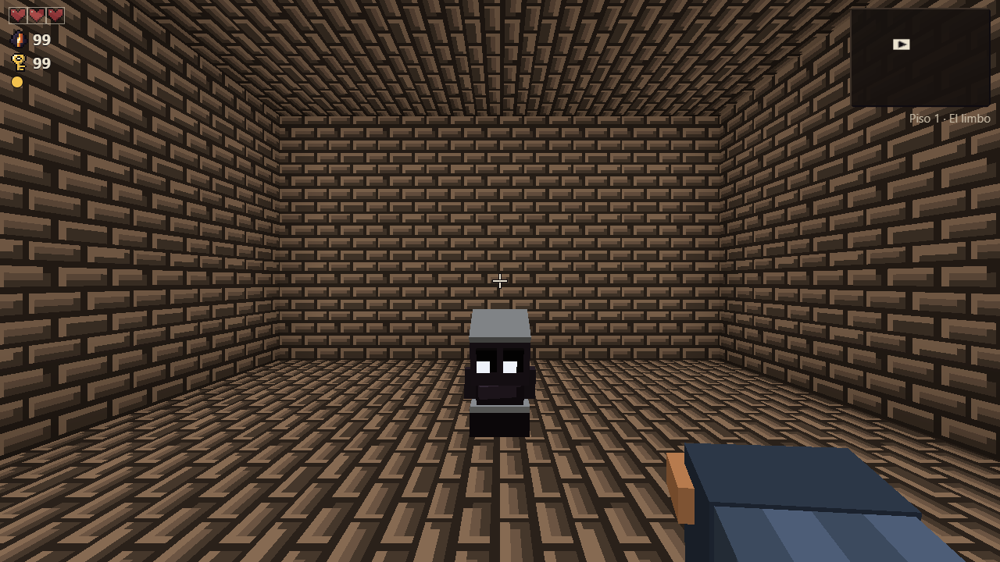

- **Kind and floors:** projection; all floors (no range in the roster).
- **What it is:** self-doubt. It keeps you still, because still is safe. A medium, dark figure hunched over a sack of stones it drags.
- **Document:** [DOUBT.md](../projections/DOUBT.md).

### Inner Critic

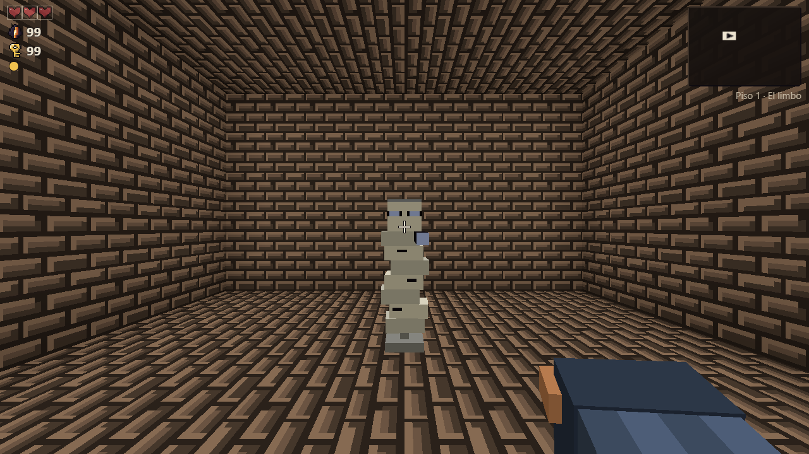

- **Kind and floors:** projection; all floors (no range in the roster).
- **What it is:** the judging voice. It wants you to be accepted, so it judges you first.
- **Document:** [INNER-CRITIC.md](../projections/INNER-CRITIC.md).

### Panic

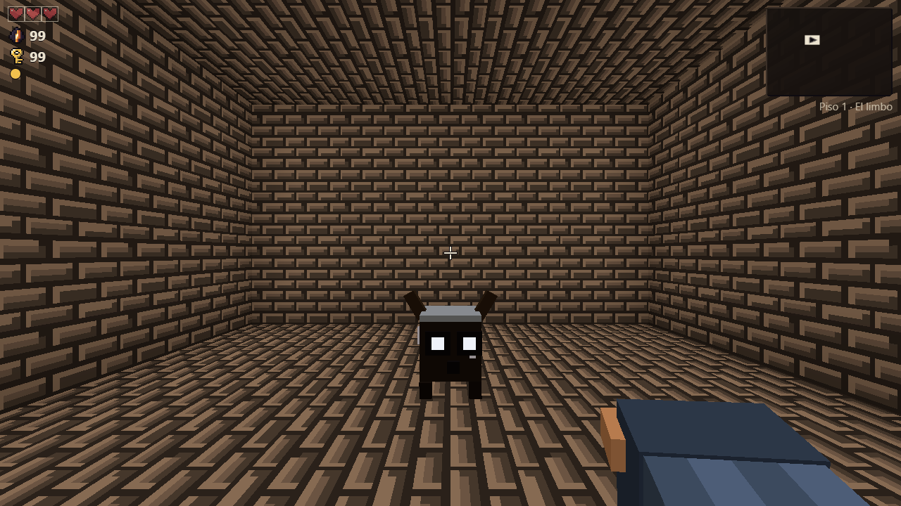

- **Kind and floors:** projection; all floors, and a second roster entry from floor 3.
- **What it is:** anxiety spiralling into panic, an alarm that rings when nothing is on fire.
- **Document:** [PANIC.md](../projections/PANIC.md).

### Autopilot

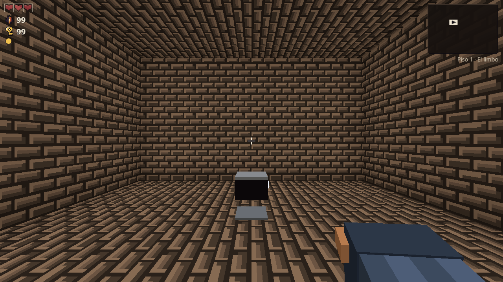

- **Kind and floors:** projection; floors 1 to 2.
- **What it is:** living by routine. It walks the same route and does not look up.
- **Document:** [AUTOPILOT.md](../projections/AUTOPILOT.md).

### Craving

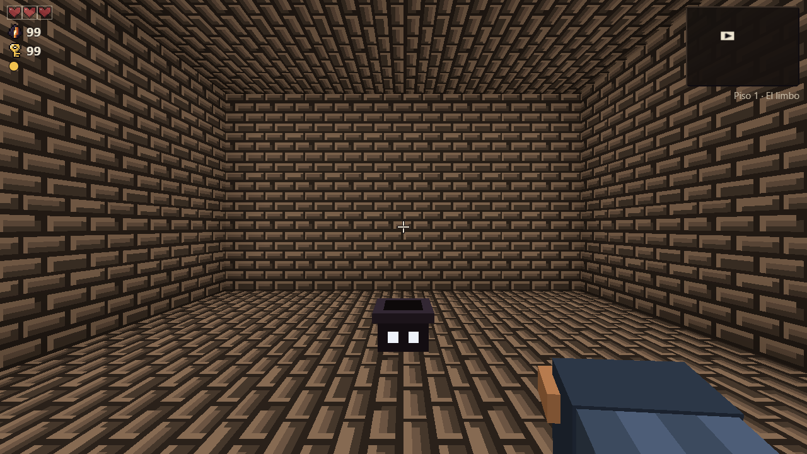

- **Kind and floors:** projection; floors 1 to 2.
- **What it is:** wanting that never fills. "Just one more."
- **Document:** [CRAVING.md](../projections/CRAVING.md).

### Impulse

- **Kind and floors:** projection; floors 1 to 2.
- **What it is:** acting before thinking. It leaps before it has looked.
- **Document:** [IMPULSE.md](../projections/IMPULSE.md).

### Avoidance

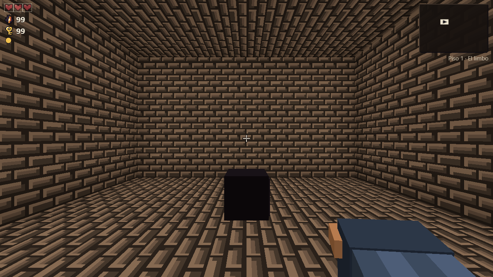

- **Kind and floors:** projection; floors 1 to 2.
- **What it is:** looking away from what hurts. "Not now."
- **Document:** [AVOIDANCE.md](../projections/AVOIDANCE.md).

### Distraction

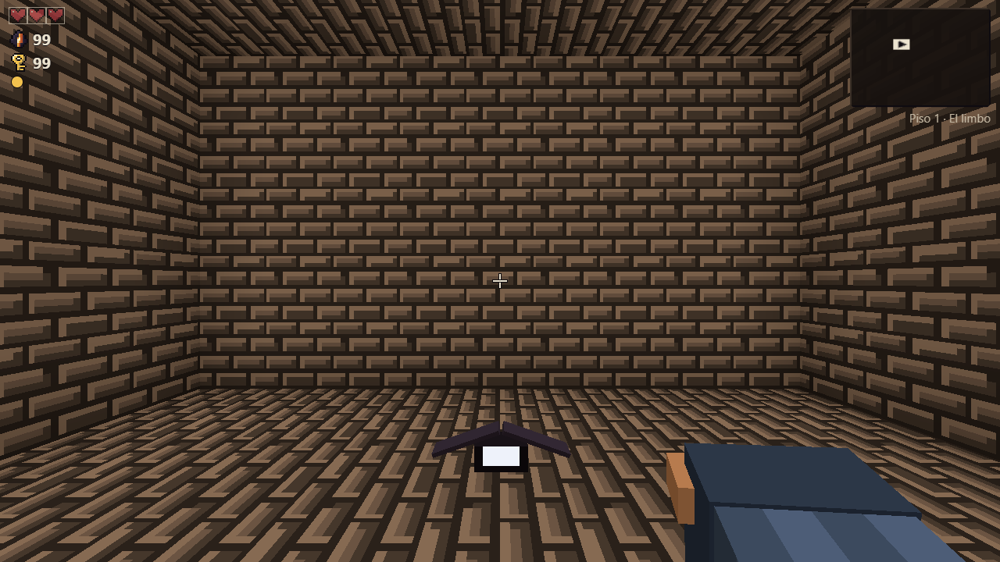

- **Kind and floors:** projection; floors 1 to 5.
- **What it is:** scattered attention. "Ooh, what is that?"
- **Document:** [DISTRACTION.md](../projections/DISTRACTION.md).

### Procrastination

- **Kind and floors:** projection; floors 2 to 5. It splits.
- **What it is:** putting things off. A slow, sleepy blob of three crooked crates.
- **Document:** [PROCRASTINATION.md](../projections/PROCRASTINATION.md).

### Procrastination B

- **Kind and floors:** split only (the roster never rolls it).
- **What it is:** the middle split of Procrastination: a smaller Later.
- **Document:** [PROCRASTINATION-B.md](../projections/PROCRASTINATION-B.md).

### Procrastination C

- **Kind and floors:** split only (the roster never rolls it).
- **What it is:** the smallest split: a fast Later.
- **Document:** [PROCRASTINATION-C.md](../projections/PROCRASTINATION-C.md).

### Undertow

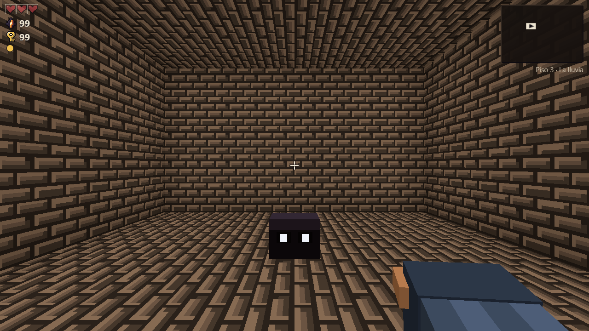

- **Kind and floors:** projection; floors 3 to 4.
- **What it is:** being overwhelmed. "It is too much."
- **Document:** [UNDERTOW.md](../projections/UNDERTOW.md).

### Rumination

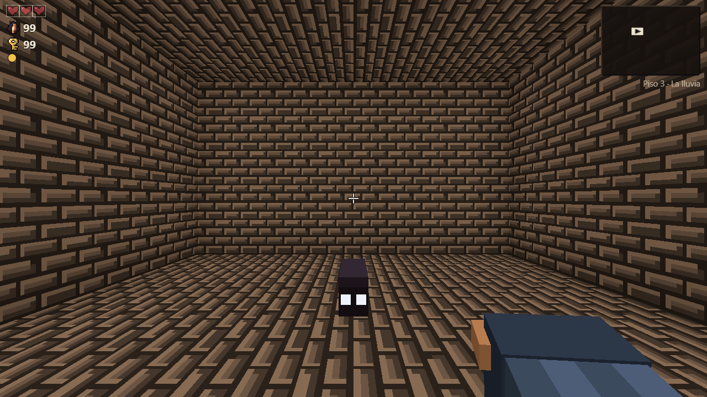

- **Kind and floors:** projection; floors 3 to 4.
- **What it is:** the thought that loops. "Again. Again. Again."
- **Document:** [RUMINATION.md](../projections/RUMINATION.md).

### Scarcity

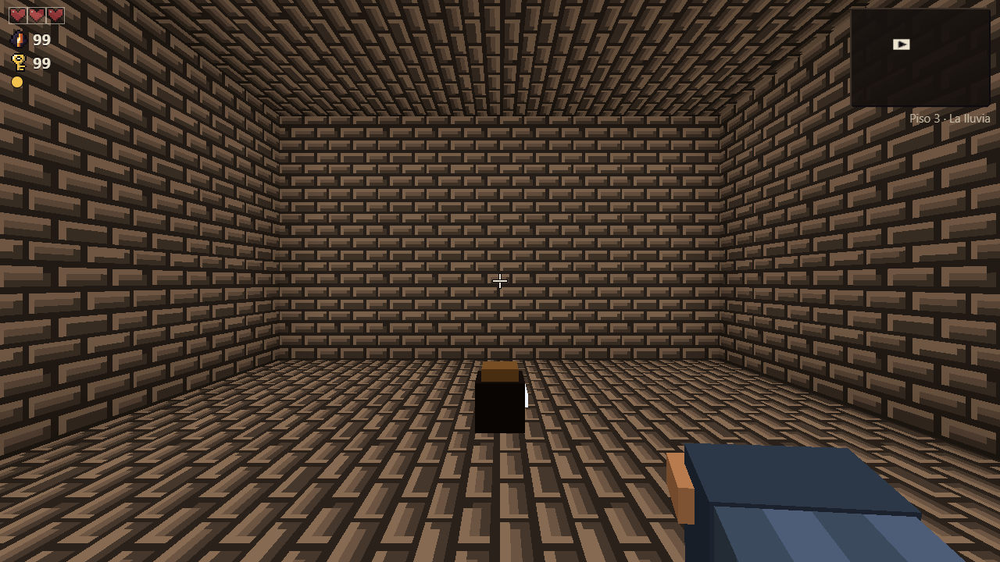

- **Kind and floors:** projection; floors 3 to 4.
- **What it is:** hoarding. "There will not be enough."
- **Document:** [SCARCITY.md](../projections/SCARCITY.md).

### Resentment

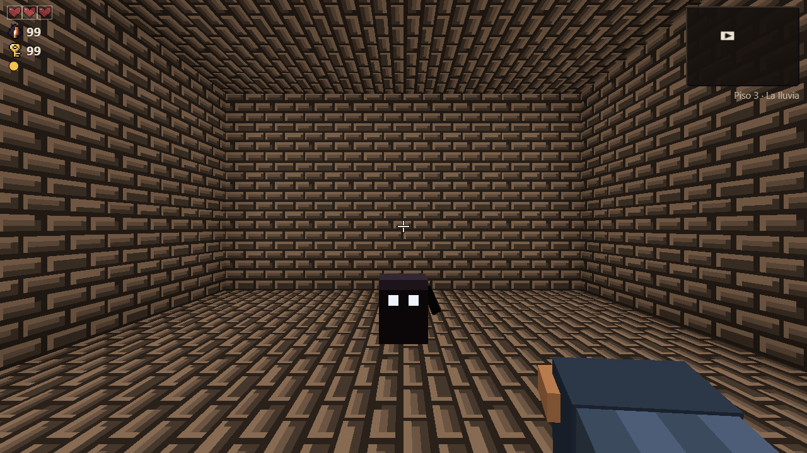

- **Kind and floors:** projection; floors 3 to 4.
- **What it is:** the grudge. "I will not forget."
- **Document:** [RESENTMENT.md](../projections/RESENTMENT.md).

### Gloom

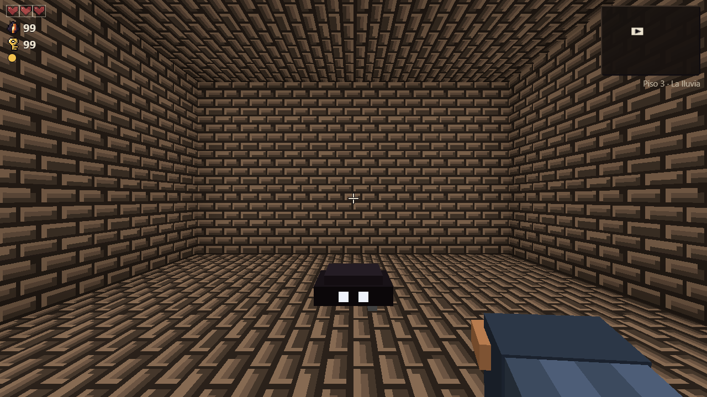

- **Kind and floors:** projection; floors 3 to 4.
- **What it is:** a heavy mood. "Everything is grey."
- **Document:** [GLOOM.md](../projections/GLOOM.md).

### Second-Guessing

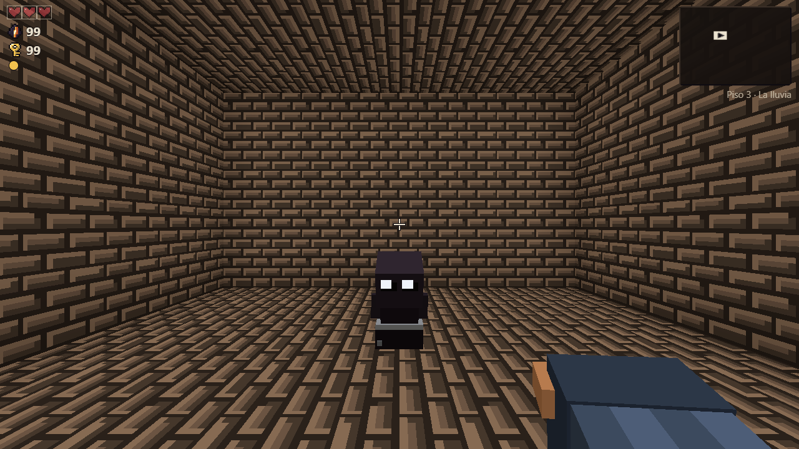

- **Kind and floors:** projection; floors 3 to 7.
- **What it is:** the second form of Doubt. "Wait, are you really sure?"
- **Document:** [SECOND-GUESSING.md](../projections/SECOND-GUESSING.md).

### Alarm

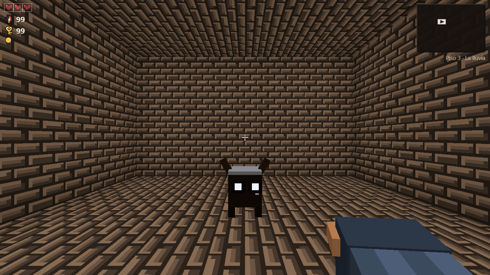

- **Kind and floors:** projection; floors 3 to 6.
- **What it is:** the second form of Panic. "Everyone, something is wrong!"
- **Document:** [ALARM.md](../projections/ALARM.md).

### Perfectionism

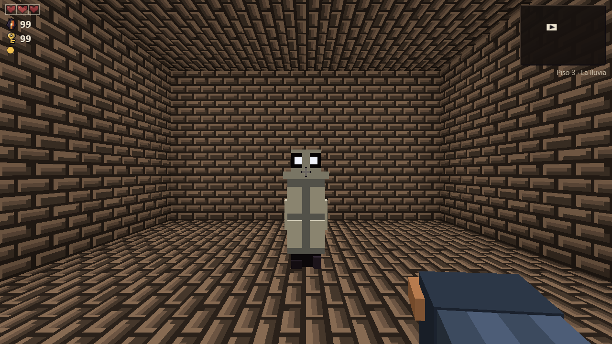

- **Kind and floors:** projection; floors 3 to 6.
- **What it is:** "It has to be perfect." It is armoured in plates.
- **Document:** [PERFECTIONISM.md](../projections/PERFECTIONISM.md).

### Comparison

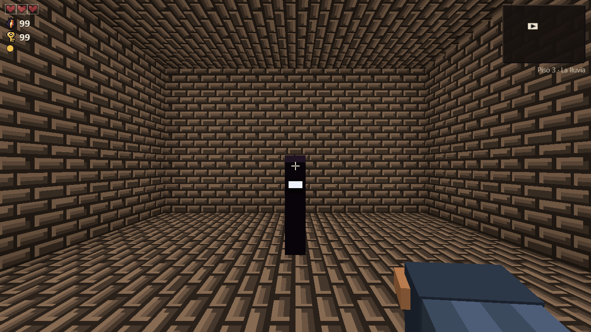

- **Kind and floors:** projection; floors 3 to 6.
- **What it is:** measuring yourself against others. "They are ahead of you."
- **Document:** [COMPARISON.md](../projections/COMPARISON.md).

### Margin

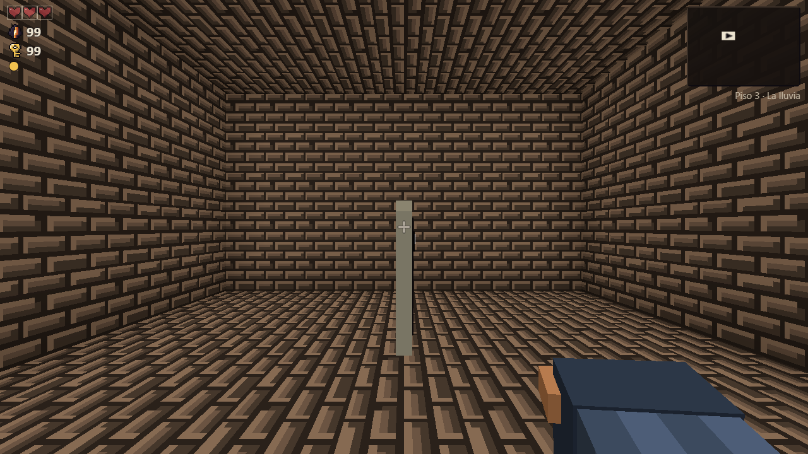

- **Kind and floors:** projection; floors 3 to 6.
- **What it is:** the second form of the Inner Critic. "And another thing…"
- **Document:** [MARGIN.md](../projections/MARGIN.md).

### Noise

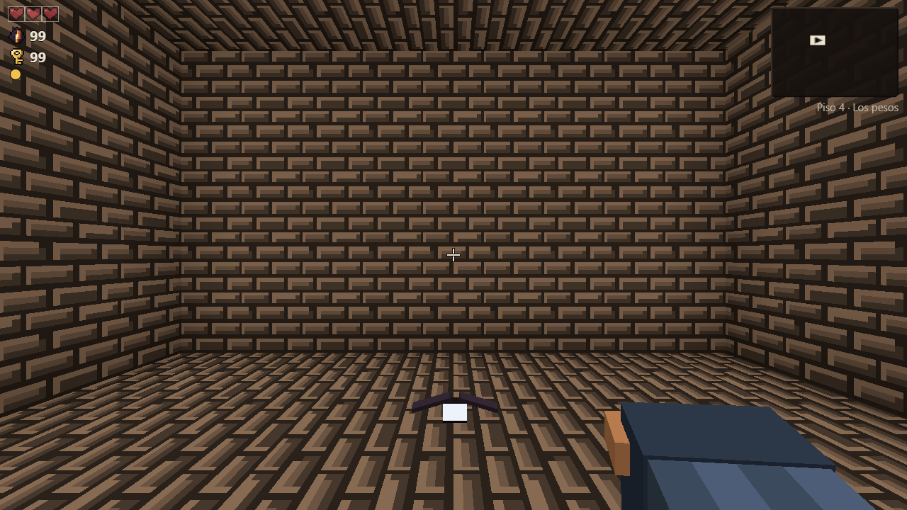

- **Kind and floors:** projection; floors 4 to 9.
- **What it is:** too many small things. "Ooh! And that! And that!"
- **Document:** [NOISE.md](../projections/NOISE.md).

### Reactivity

- **Kind and floors:** projection; floors 5 to 6.
- **What it is:** reacting in anger. "How dare you!"
- **Document:** [REACTIVITY.md](../projections/REACTIVITY.md).

### Sulk

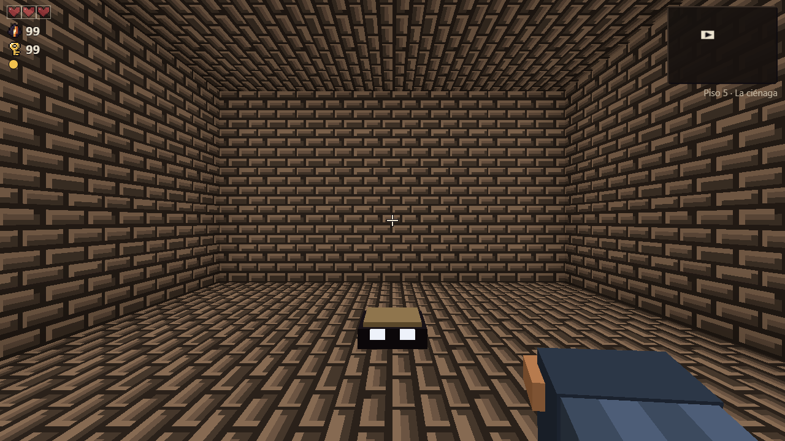

- **Kind and floors:** projection; floors 5 to 6.
- **What it is:** sullenness. "Fine."
- **Document:** [SULK.md](../projections/SULK.md).

### The Shoulds

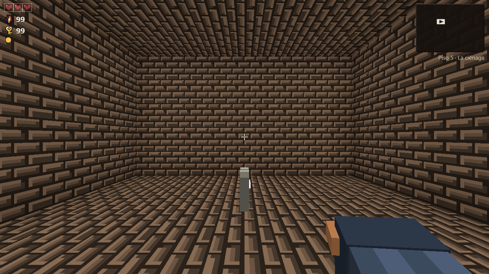

- **Kind and floors:** projection; floors 5 to 6.
- **What it is:** rigid rules. "I should… I should…"
- **Document:** [SHOULDS.md](../projections/SHOULDS.md).

### Dogma

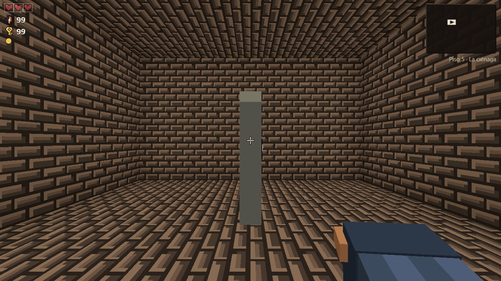

- **Kind and floors:** projection; floors 5 to 6, rare (roster weight one).
- **What it is:** a belief set in stone. "It has always been this way."
- **Document:** [DOGMA.md](../projections/DOGMA.md).

### Backlog

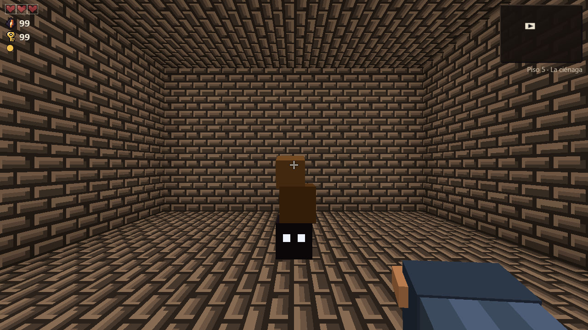

- **Kind and floors:** projection; floors 5 to 9.
- **What it is:** the later form of Procrastination. "I will get to all of it. Later."
- **Document:** [BACKLOG.md](../projections/BACKLOG.md).

### Tribunal

- **Kind and floors:** projection; floors 6 to 9.
- **What it is:** consensus. "We have all agreed."
- **Document:** [TRIBUNAL.md](../projections/TRIBUNAL.md).

### Dread

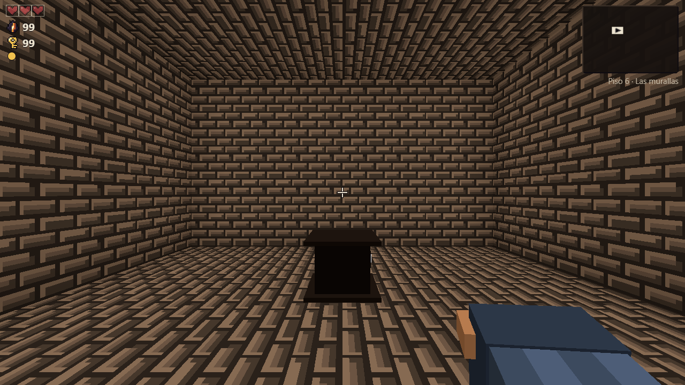

- **Kind and floors:** projection; floors 6 to 9.
- **What it is:** the third form of Panic. "Something will go wrong."
- **Document:** [DREAD.md](../projections/DREAD.md).

### Not Yet

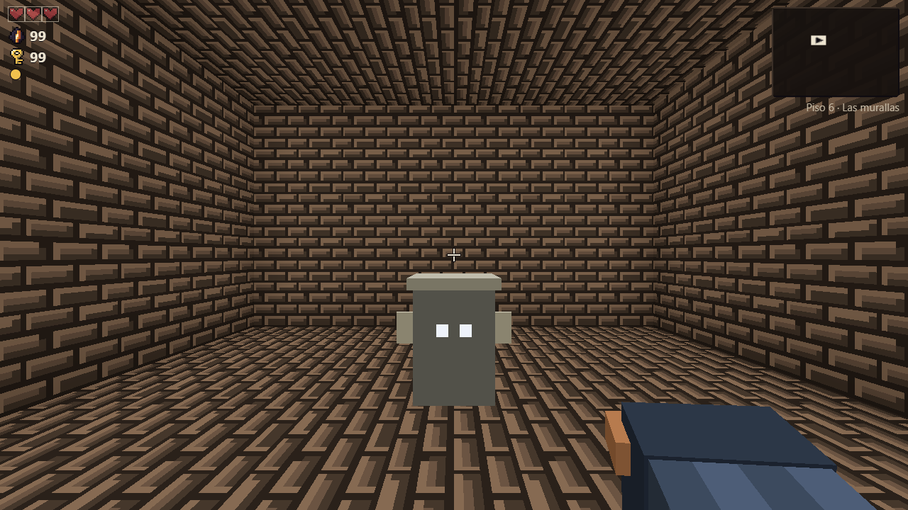

- **Kind and floors:** projection; floors 6 to 9.
- **What it is:** "Not yet. Not yet. Not yet." It mends itself toward a finish it never reaches.
- **Document:** [NOT-YET.md](../projections/NOT-YET.md).

### Paralysis

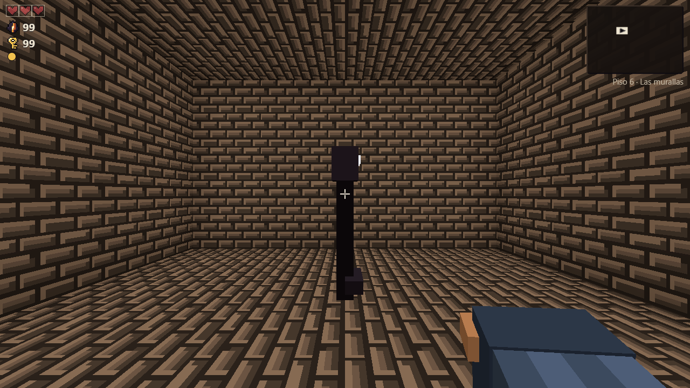

- **Kind and floors:** projection; floors 6 to 9.
- **What it is:** the third form of Doubt. "Do not move."
- **Document:** [PARALYSIS.md](../projections/PARALYSIS.md).

### Hall of Mirrors

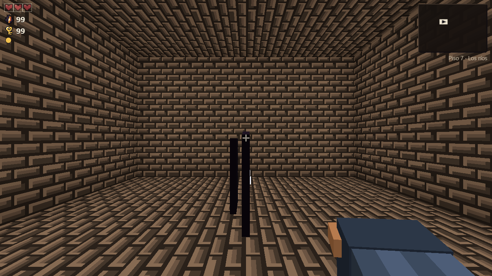

- **Kind and floors:** projection; floors 7 to 9.
- **What it is:** the third form of Comparison. "Everyone is ahead of you."
- **Document:** [HALL-OF-MIRRORS.md](../projections/HALL-OF-MIRRORS.md).

### Burnout

- **Kind and floors:** projection; floors 7 to 8.
- **What it is:** running past empty. "I cannot stop."
- **Document:** [BURNOUT.md](../projections/BURNOUT.md).

### Spark

- **Kind and floors:** projection; floors 7 to 8.
- **What it is:** always on edge. "Is that? What was that?"
- **Document:** [SPARK.md](../projections/SPARK.md).

### Pretence

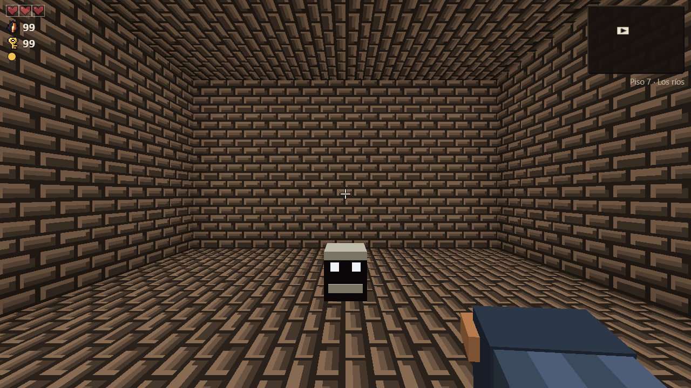

- **Kind and floors:** projection; floors 7 to 8.
- **What it is:** the mask. "I am fine."
- **Document:** [PRETENCE.md](../projections/PRETENCE.md).

### Shortcut

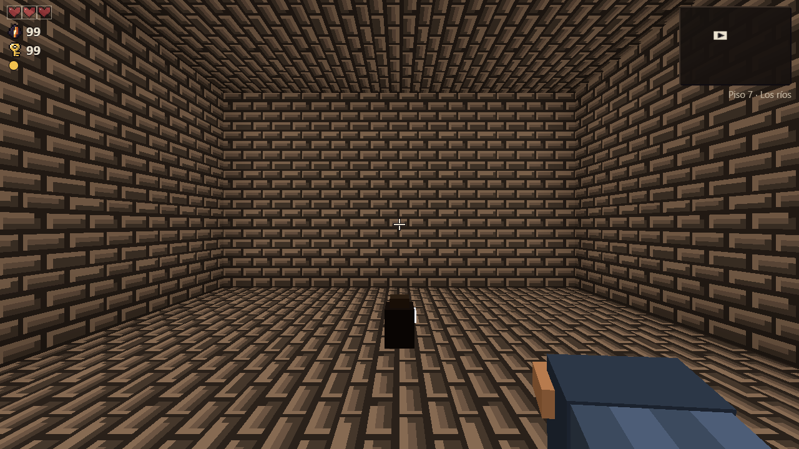

- **Kind and floors:** projection; floors 7 to 8 (roster weight one).
- **What it is:** cutting corners. "There is an easier way."
- **Document:** [SHORTCUT.md](../projections/SHORTCUT.md).

### Numbness

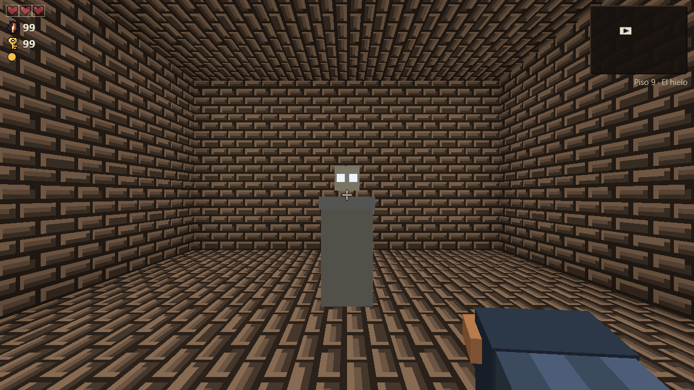

- **Kind and floors:** projection; floor 9.
- **What it is:** not feeling anything. "I do not feel anything."
- **Document:** [NUMBNESS.md](../projections/NUMBNESS.md).

### Cynicism

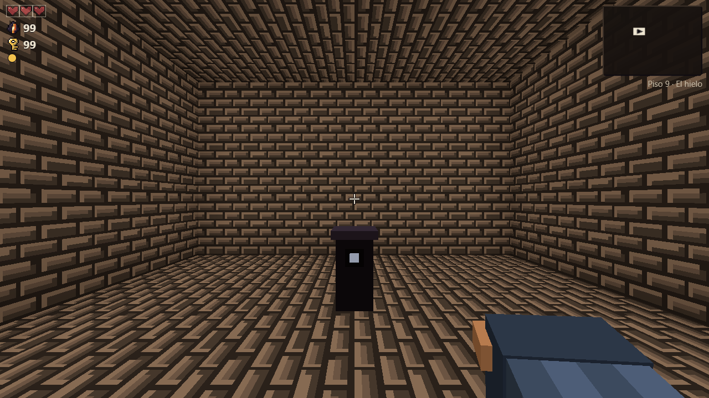

- **Kind and floors:** projection; floor 9.
- **What it is:** giving up before trying. "What is the point?"
- **Document:** [CYNICISM.md](../projections/CYNICISM.md).

### Isolation

- **Kind and floors:** projection; floor 9.
- **What it is:** withdrawing. "Leave me alone."
- **Document:** [ISOLATION.md](../projections/ISOLATION.md).

### What If

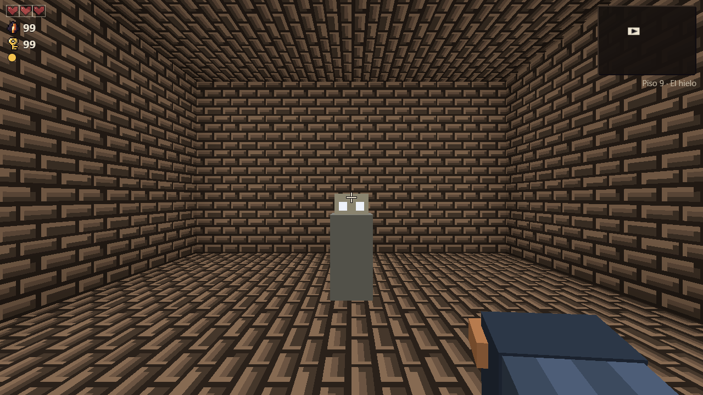

- **Kind and floors:** projection; floor 9.
- **What it is:** regret. "What if I had…"
- **Document:** [WHAT-IF.md](../projections/WHAT-IF.md).

---

## 2. Creatures

Thirteen creatures, in `src/content/creatures/`, placed as ambient life by `CREATURE_LIFE` in `src/content/creatures/index.ts`. They are neutral: no projection hunts them and they hunt nothing. None drops a pickup or a part. The shared rules (growth from warm love shots, hiding instead of dying, the growth gift, the seal and clear) are in [creatures](../creatures/README.md).

### Wonder

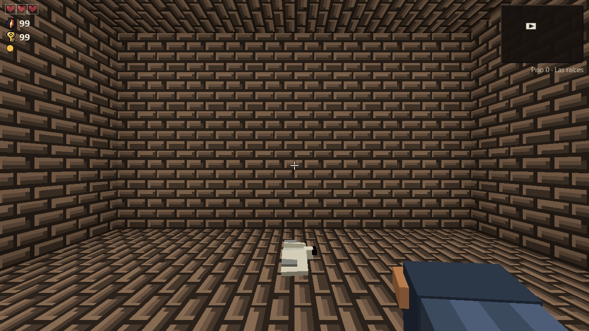

- **Kind and floors:** creature; floor 0, two to four in the roots.
- **What it is:** curiosity that leads down. A small moth of pale paper.
- **Document:** [WONDER.md](../creatures/WONDER.md).

### Rootling

- **Kind and floors:** creature; floor 0, two to three.
- **What it is:** curiosity. A tiny root-shaped creature on two short legs.
- **Document:** [ROOTLING.md](../creatures/ROOTLING.md).

### Mossling

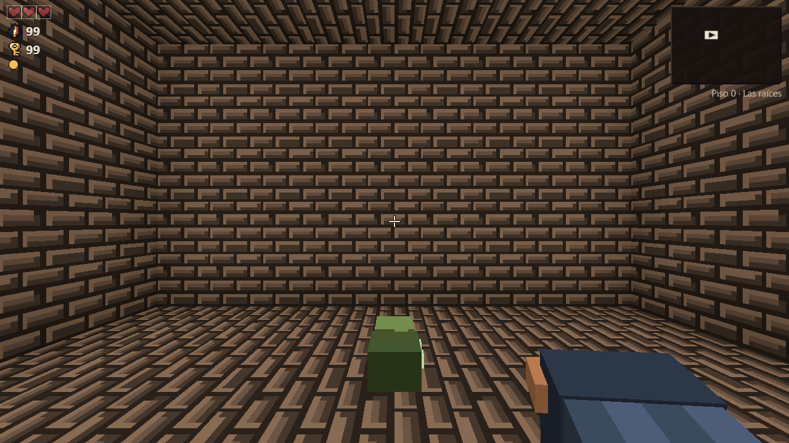

- **Kind and floors:** creature; floor 0, two to three.
- **What it is:** rest. A round moss creature asleep on the floor. The first creature that answers only positive intentions.
- **Document:** [MOSSLING.md](../creatures/MOSSLING.md).

### Chirper

- **Kind and floors:** creature; floors 1 to 2, two to three.
- **What it is:** the gut feeling: a cellar cricket with two glowing eyes.
- **Document:** [CHIRPER.md](../creatures/CHIRPER.md).

### Delver

- **Kind and floors:** creature; floors 1 to 3, one or two per floor.
- **What it is:** play. A small digger with a cap of dirt on its back.
- **Document:** [DELVER.md](../creatures/DELVER.md).

### Leafling

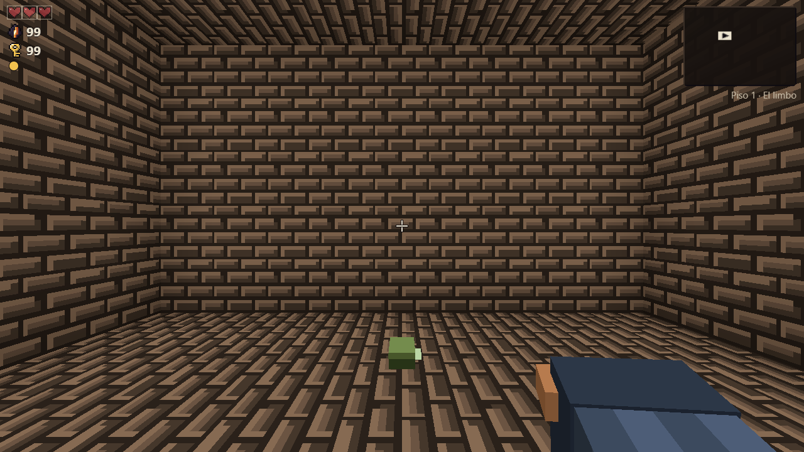

- **Kind and floors:** creature; floors 1 to 5, one or two per floor.
- **What it is:** wonder. A flat leaf-shaped light with one glowing point. It answers only positive intentions.
- **Document:** [LEAFLING.md](../creatures/LEAFLING.md).

### Star-mite

- **Kind and floors:** creature; floors 1 to 5, one or two per floor.
- **What it is:** joining what is apart. A dark mite with three glowing points in a triangle, like a constellation. It answers only positive intentions.
- **Document:** [STAR-MITE.md](../creatures/STAR-MITE.md).

### Bubbler

- **Kind and floors:** creature; floors 3 to 4, one or two per floor.
- **What it is:** breath, the body's rhythm. A small deep-water fish with a dark tail and a pale head.
- **Document:** [BUBBLER.md](../creatures/BUBBLER.md).

### Ferryback

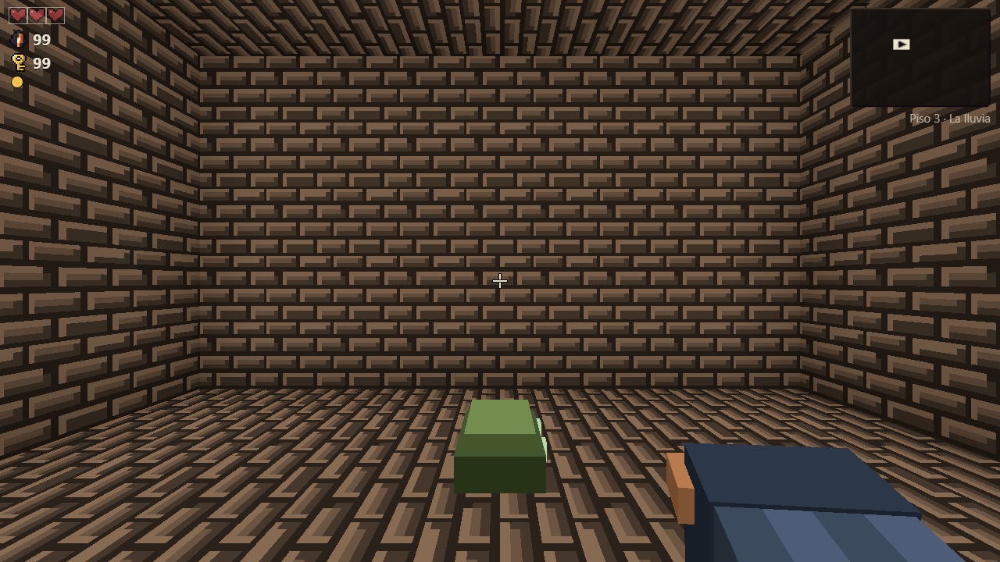

- **Kind and floors:** creature; floors 3 to 4, exactly one per floor.
- **What it is:** being carried. A slow, broad creature of deep water with a flat, pale back. The largest creature.
- **Document:** [FERRYBACK.md](../creatures/FERRYBACK.md).

### Drifter

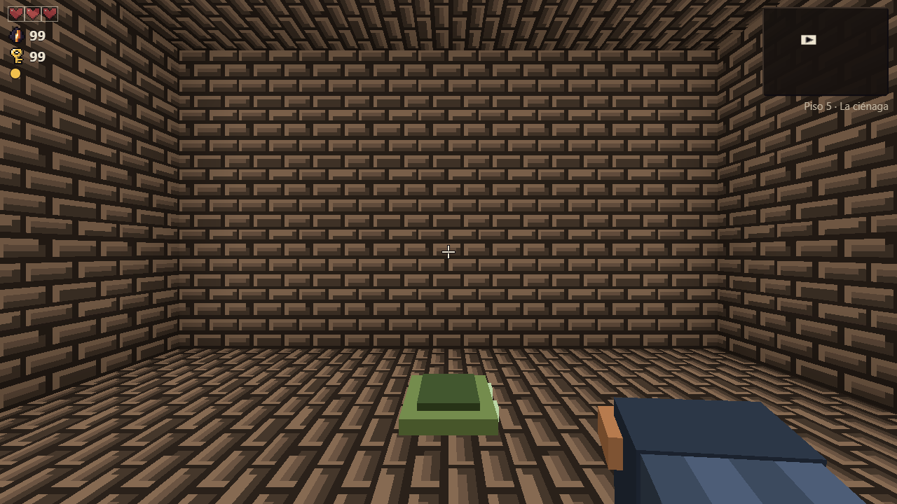

- **Kind and floors:** creature; floors 5 to 6, one or two per floor.
- **What it is:** lightness. A flat pale plate with a low dome on its back.
- **Document:** [DRIFTER.md](../creatures/DRIFTER.md).

### Inkmite

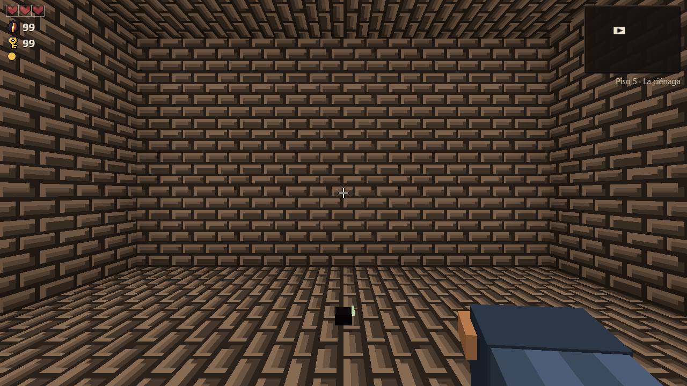

- **Kind and floors:** creature; floors 5 to 6, two or three per floor.
- **What it is:** letting things go. A tiny mite black as ink.
- **Document:** [INKMITE.md](../creatures/INKMITE.md).

### Cinderwalker

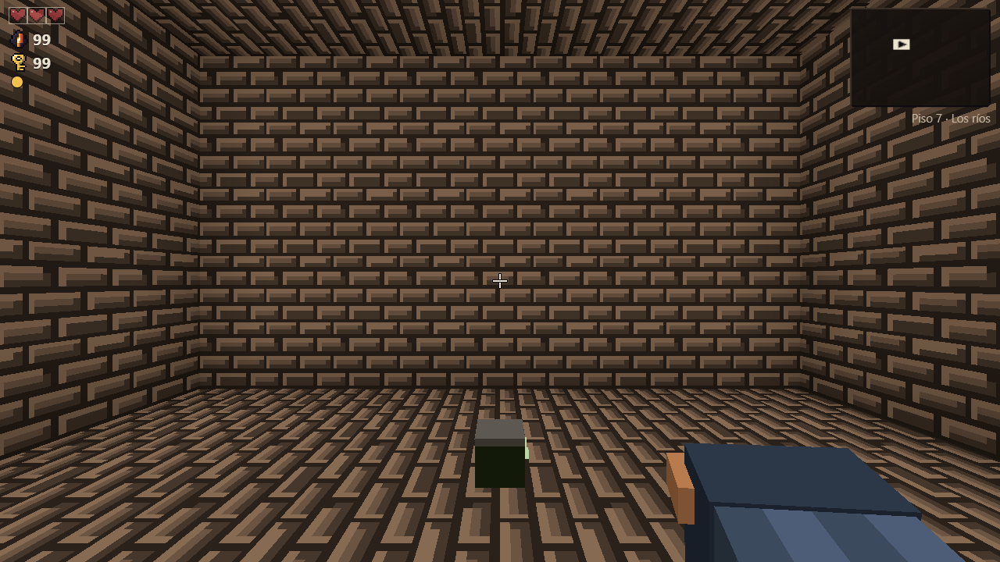

- **Kind and floors:** creature; floors 7 to 8, one or two per floor.
- **What it is:** walking through fire without being consumed.
- **Document:** [CINDERWALKER.md](../creatures/CINDERWALKER.md).

### Huddler

- **Kind and floors:** creature; floor 9, two or three.
- **What it is:** warmth shared. A small round creature with a rim of frost. It answers only positive intentions.
- **Document:** [HUDDLER.md](../creatures/HUDDLER.md).

---

## 3. Bosses

Fourteen bosses in `src/content/bosses/`. Each floor draws its boss from its zone's pool by the run's seed; a boss already fought in the run is not drawn again. Floor 5 (The Threshold Guardian) and floor 9 (The Shadow) are keystones with a fixed boss. The pools are in [bosses](../bosses/README.md); the fight, its phases, the defeat, the pedestal and the toll are in [fight flow](../bosses/FIGHT-FLOW.md). Each boss is shown in a larger room (see [How the pictures were taken](#how-the-pictures-were-taken)).

### Resistance

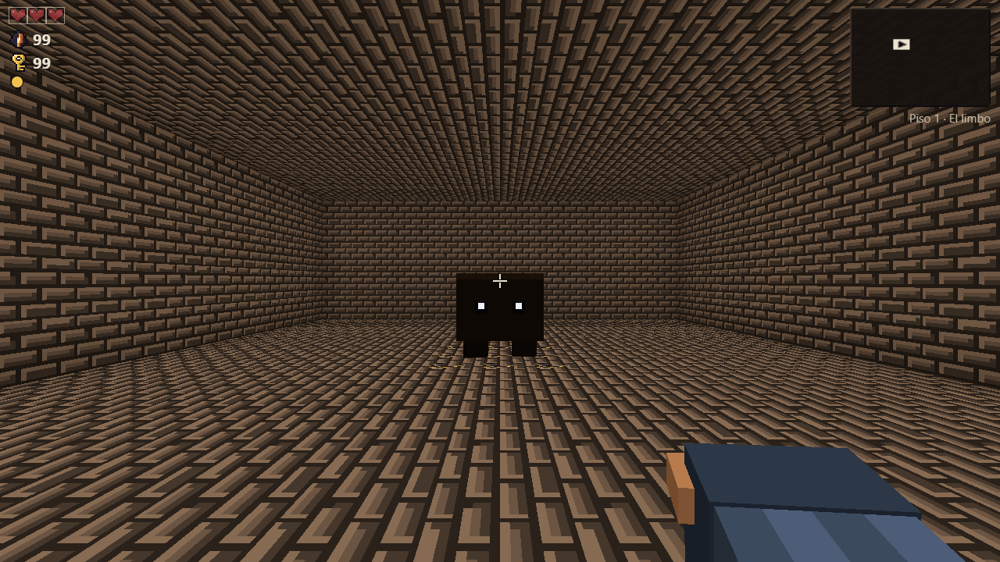

- **Kind and floors:** boss; floors 1 to 2, Zone I pool.
- **What it is:** the force that stops creative work. A slab of brick on two short legs, with two dim eyes under its lintel.
- **Document:** [RESISTANCE.md](../bosses/RESISTANCE.md).

### Inertia

- **Kind and floors:** boss; floors 1 to 2, Zone I pool.
- **What it is:** staying as you are. Rest that became a stop.
- **Document:** [INERTIA.md](../bosses/INERTIA.md).

### The Insatiable

- **Kind and floors:** boss; floors 1 to 2, Zone I pool.
- **What it is:** craving, grown old. A giant open cup of stone with a maw at floor level. It never walks: the room comes to it.
- **Document:** [INSATIABLE.md](../bosses/INSATIABLE.md).

### Overwhelm

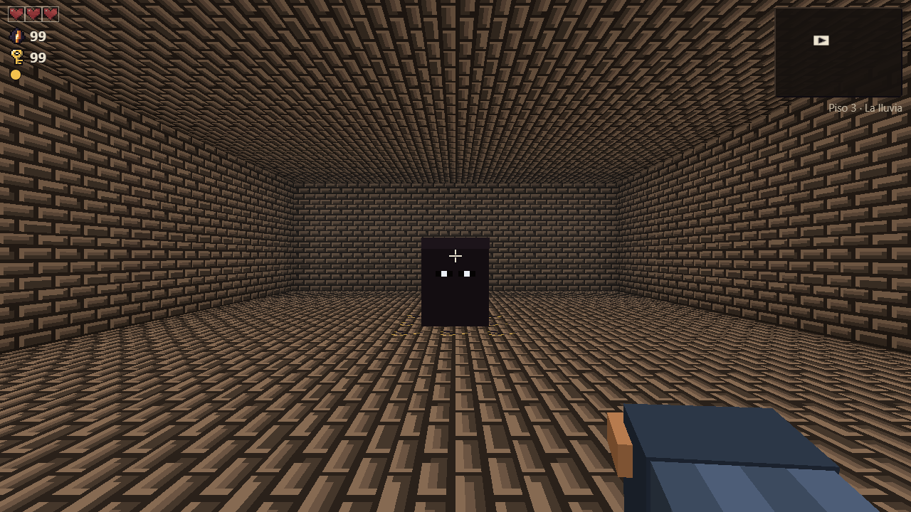

- **Kind and floors:** boss; floors 3 to 4, Zone II pool.
- **What it is:** too much at once. A tide with a face of foam that surges and sends waves across the room.
- **Document:** [OVERWHELM.md](../bosses/OVERWHELM.md).

### The Hoard

- **Kind and floors:** boss; floors 3 to 4, Zone II pool.
- **What it is:** holding on to everything. A mound of crates, stones and bundles that rolls weights across the room and pulls loose things back to its pile.
- **Document:** [HOARD.md](../bosses/HOARD.md).

### The Downpour

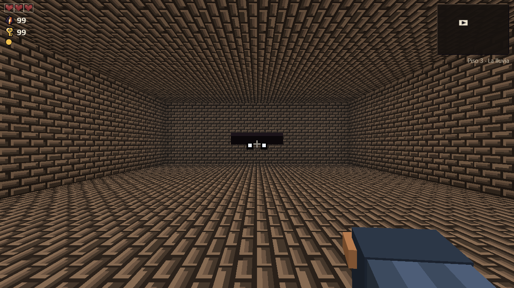

- **Kind and floors:** boss; floors 3 to 4, Zone II pool.
- **What it is:** a cloud that keeps the room grey. A ceiling of cloud the size of the arena that rains drops on where the player is going.
- **Document:** [DOWNPOUR.md](../bosses/DOWNPOUR.md).

### The Threshold Guardian

- **Kind and floors:** boss; floor 5, the keystone of the great pit.
- **What it is:** the fear at the edge of change. A tall gate of stone with two pillars and a lintel.
- **Document:** [THRESHOLD-GUARDIAN.md](../bosses/THRESHOLD-GUARDIAN.md). The design's second route of light is not built.

### Verdict

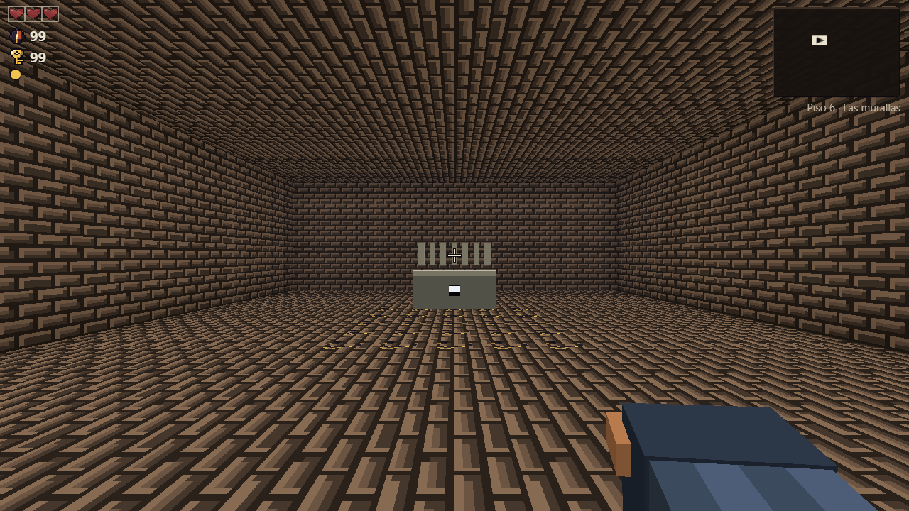

- **Kind and floors:** boss; floor 6, Zone III pool.
- **What it is:** the Tribunal grown old: a long bench of ledger stone with seven lecterns.
- **Document:** [VERDICT.md](../bosses/VERDICT.md). Built in part.

### The Grudge

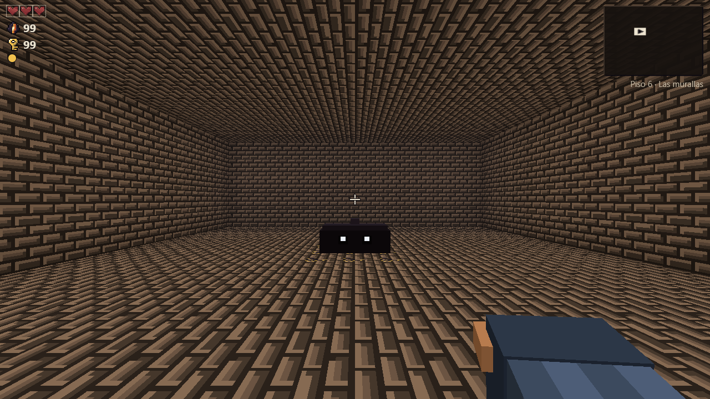

- **Kind and floors:** boss; floor 6, Zone III pool.
- **What it is:** resentment grown old. Something huge under the marsh, showing only a back of mud and two eyes.
- **Document:** [GRUDGE.md](../bosses/GRUDGE.md). Built in part.

### The Old Rule

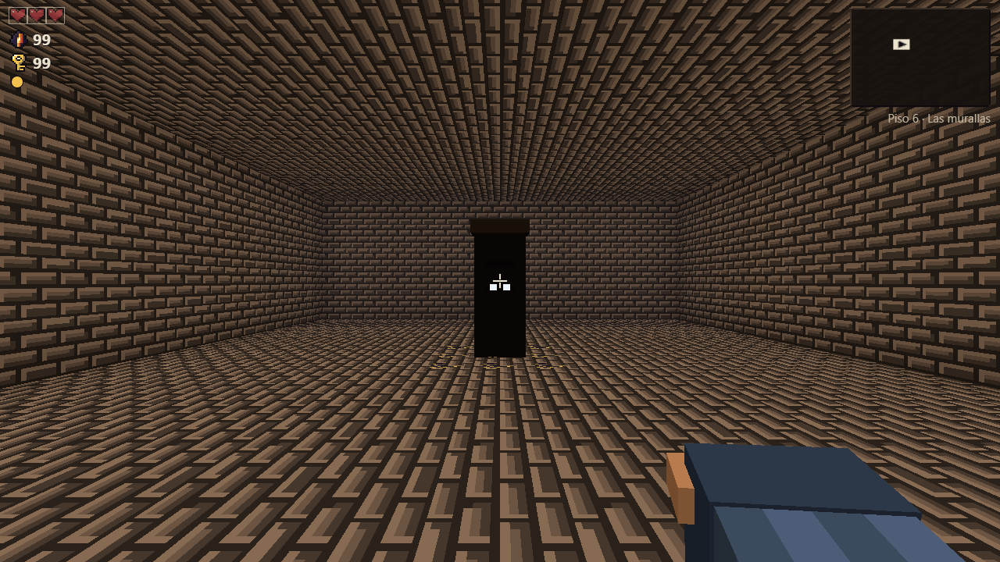

- **Kind and floors:** boss; floor 6, Zone III pool.
- **What it is:** a belief from childhood. A tall stone tablet with two dim eyes that issues rules.
- **Document:** [OLD-RULE.md](../bosses/OLD-RULE.md). Built in part.

### The Furnace

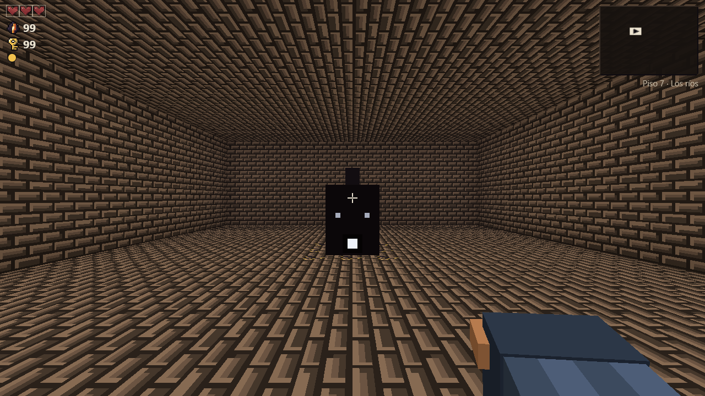

- **Kind and floors:** boss; floors 7 to 8, Zone IV pool.
- **What it is:** Burnout grown old. A great furnace of obsidian and brick with a mouth for a door.
- **Document:** [FURNACE.md](../bosses/FURNACE.md). Built in part.

### The Impostor

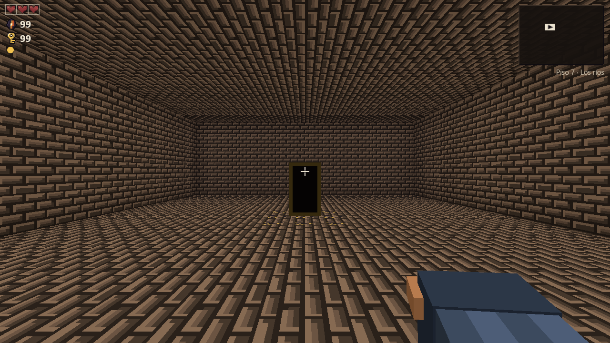

- **Kind and floors:** boss; floors 7 to 8, Zone IV pool.
- **What it is:** fear of being found out. A hollow frame of brass with a smile too wide for it; a small real figure is inside.
- **Document:** [IMPOSTOR.md](../bosses/IMPOSTOR.md). Built in part.

### The Many Faces

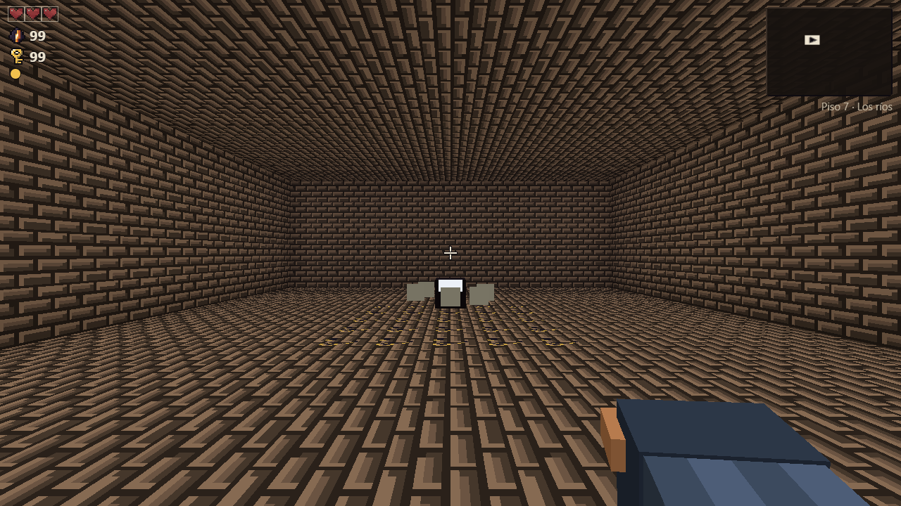

- **Kind and floors:** boss; floors 7 to 8, Zone IV pool.
- **What it is:** a face for everyone. A cube with two bright eyes and a ring of masks.
- **Document:** [MANY-FACES.md](../bosses/MANY-FACES.md). Built in part.

### The Shadow

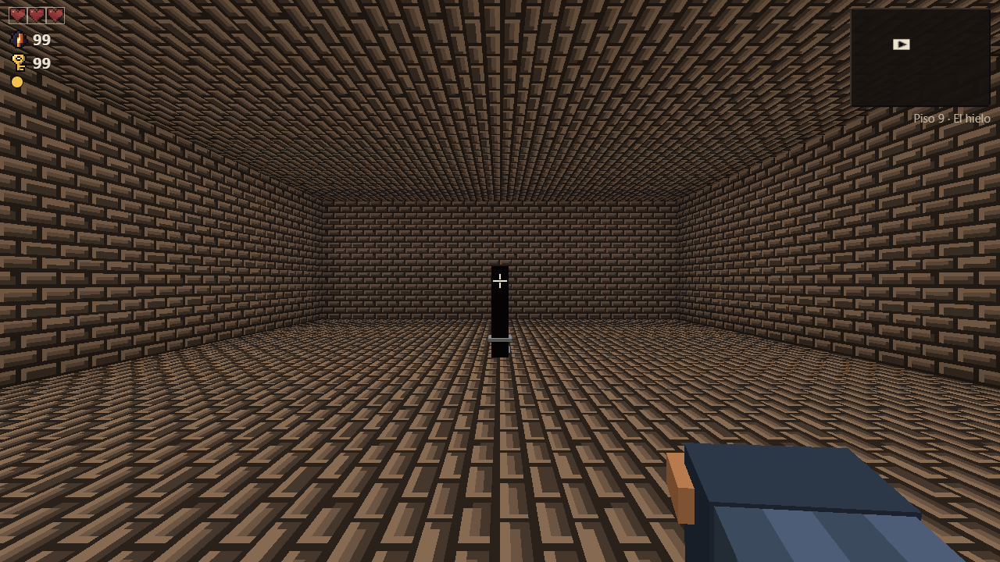

- **Kind and floors:** boss; floor 9, the keystone of the frozen bottom.
- **What it is:** everything you do not want to see in yourself: the player's silhouette in the room's negative.
- **Document:** [SHADOW.md](../bosses/SHADOW.md). Its defeat has no toll.

---

## 4. Presences

Three presences. They are immortal, never gods or people, and never give orders. Shared rules: [presences](../presences/README.md).

### The Listener

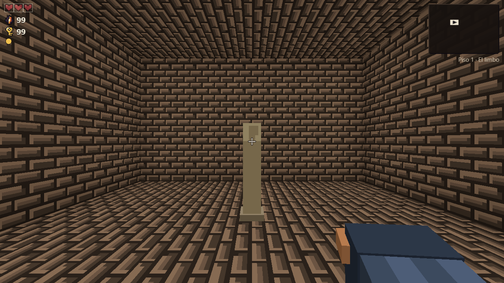

- **Kind and floors:** presence; one per floor from 1 to 5, in a quiet normal room with no projections (floor 0 has none).
- **What it is:** being heard. A pale stone figure of bone, a tall column with a paper-coloured head and two small side plates.
- **Document:** [LISTENER.md](../presences/LISTENER.md).

### The Gardener

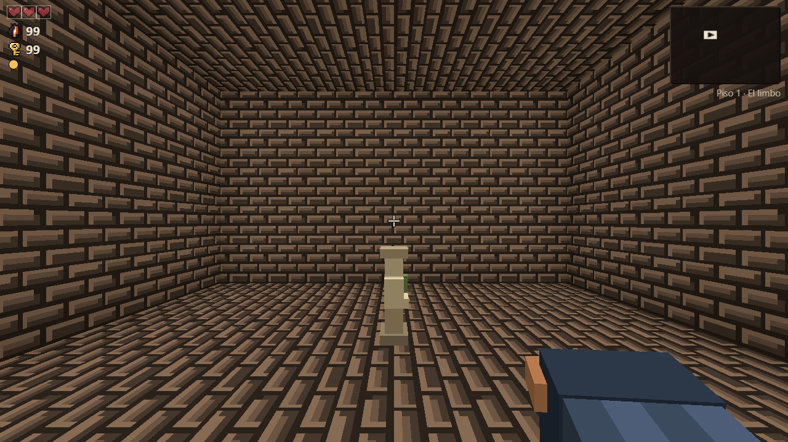

- **Kind and floors:** presence; defined in `src/content/presences/gardener.ts`, **not placed** in any floor (the owner ruled on 2026-10-29 that the tutorial floor holds none).
- **What it is:** care, patience and cultivation. A bone-coloured figure with its arms held out and a few living tones on its hands.
- **Document:** [GARDENER.md](../../not-built/presences/GARDENER.md) (not built).

### The Boundary

- **Kind and floors:** presence in the design, projection kind in the code; one per vault of a dungeon floor from floor 1 on, and above the tutorial treasure chest (`src/world/floor.ts`).
- **What it is:** boundaries. A tall, calm column of limestone that keeps the vault it stands in.
- **Document:** [BOUNDARY.md](../presences/BOUNDARY.md). Its picture is the Boundary alone, without its vault or its ring of blocks: the sandbox has no chest, so no ring is built.

---

## 5. Voices

A voice here is speech that has no body of its own. The game has one such entity.

### The Sanctuary's guidance

- **Kind and floors:** voice; the Boundary's meditation app, opened when the player walks up to a Boundary that still keeps its chest, and above the tutorial chest. Available on every floor where a Boundary stands.
- **What it is:** the guided voice of the Sanctuary, a full-screen app of six meditations, each with its own scene, music and words. The app's name is the Boundary's ring.
- **Screenshot:** none. This voice has no body: it is words, a scene and a sound on the app's own screen, not a creature. Nothing is faked for it.
- **Document:** [MEDITATION-APP.md](../presences/MEDITATION-APP.md).

---

## 6. The sky guardians

Five deities, one on each sky floor of the built sky tree, in `src/sky/`. Each is a small soft body under a giant animal head, floating over its seat, won by positive hits. What they share is in [sky/guardians](../sky/guardians/README.md). Each picture is taken at rest, as described above.

### Giant panda

- **Kind and floors:** sky guardian; sky floor 1, the bamboo seat.
- **What it is:** a giant panda head on a plush body. It rests between attacks.
- **Meaning:** not yet documented.
- **Document:** [PANDA.md](../sky/guardians/PANDA.md).

### Koala

- **Kind and floors:** sky guardian; sky floor 2, the branches (the Fork).
- **What it is:** a koala asleep until the player comes near. It clings to its branch and teleports across the floor.
- **Meaning:** not yet documented.
- **Document:** [KOALA.md](../sky/guardians/KOALA.md).

### Elephant

- **Kind and floors:** sky guardian; sky floor 3, the channels (the Basin).
- **What it is:** an elephant listening over the Basin pool. Its spray carries the player down the channels.
- **Meaning:** not yet documented.
- **Document:** [ELEPHANT.md](../sky/guardians/ELEPHANT.md).

### Lion

- **Kind and floors:** sky guardian; sky floor 4, the plain (the Sunning Ledge).
- **What it is:** a lion basking on its ledge. A roar sends a ring of paralysis across the ground.
- **Meaning:** not yet documented.
- **Document:** [LION.md](../sky/guardians/LION.md).

### Horse

- **Kind and floors:** sky guardian; sky floor 5, the meadow (the paddocks).
- **What it is:** the only deity that walks and leaps, between six fenced paddocks. Its picture shows its head over a paddock fence, watching.
- **Meaning:** not yet documented.
- **Document:** [HORSE.md](../sky/guardians/HORSE.md).

---

## 7. The sky minions

Five herds, one per sky floor: the animals of each floor, embodied as smaller creatures. Each picture shows one member of its herd. The engine, the spawn places, the counts and the herd rules are in [sky/minions](../sky/minions/README.md): every herd spawns while the player is on its floor and turns to the player's side after the number of positive hits in its row.

### Little pandas

- **Kind and floors:** sky minion (a herd); sky floor 1, spawns at the bamboo clumps; turns after 3 positive hits.
- **What it is:** small pandas that walk slowly, climb, roll and sit.
- **Meaning:** not yet documented.
- **Document:** [sky/minions](../sky/minions/README.md) (the herd's row in its table).

### Koalas

- **Kind and floors:** sky minion (a herd); sky floor 2, asleep in clusters; turns after 3 positive hits.
- **What it is:** koalas that sleep until disturbed, hang under branches and drop on a passing player.
- **Meaning:** not yet documented.
- **Document:** [sky/minions](../sky/minions/README.md) (the herd's row in its table).

### Young elephants

- **Kind and floors:** sky minion (a herd); sky floor 3, the waterhole; turns after 5 positive hits.
- **What it is:** young elephants that walk the ground ring in file and shoulder aside a player in the way.
- **Meaning:** not yet documented.
- **Document:** [sky/minions](../sky/minions/README.md) (the herd's row in its table).

### The pride

- **Kind and floors:** sky minion (a herd); sky floor 4, the shade rocks; turns after 4 positive hits.
- **What it is:** lions that stalk low, pounce from above and roar a small freeze.
- **Meaning:** not yet documented.
- **Document:** [sky/minions](../sky/minions/README.md) (the herd's row in its table).

### The herd

- **Kind and floors:** sky minion (a herd); sky floor 5, the paddock gate; turns after 4 positive hits.
- **What it is:** horses that gallop a wide loop and kick a player standing behind them.
- **Meaning:** not yet documented.
- **Document:** [sky/minions](../sky/minions/README.md) (the herd's row in its table).

---

## Gaps

These are the entities this bestiary cannot yet describe fully or picture. Each entry above says the same thing where it applies.

### Screenshots not taken

- **None for a creature, presence, projection or sky entity.** Every entity listed above has a picture from the game, taken as described in [How the pictures were taken](#how-the-pictures-were-taken).
- **The Sanctuary's guidance** (section 5) has no body, so it has no picture by design: it is words, a scene and a sound on the app's own screen.

### Meaning not yet documented

- **The sky guardians** (section 6: Giant panda, Koala, Elephant, Lion, Horse) and **the sky herds** (section 7: little pandas, koalas, young elephants, the pride, the herd). The built sky documents describe what they do, not what they mean, so each entry says "not yet documented". The owner is asked for their meaning.
- **The Gardener:** its meaning is written in the design, but it is not placed (the owner ruled on 2026-10-29), so the meaning is recorded as not built.

## Found while writing

- The Wonder's `minFloor` is 99 in the code, while the creature table places it on floor 0 (the table decides placement). Recorded in [WONDER.md](../creatures/WONDER.md).
- Doubt, Inner Critic and Panic have no floor range in the roster, while their cards give floors 1 to 4 (open questions in their documents).
